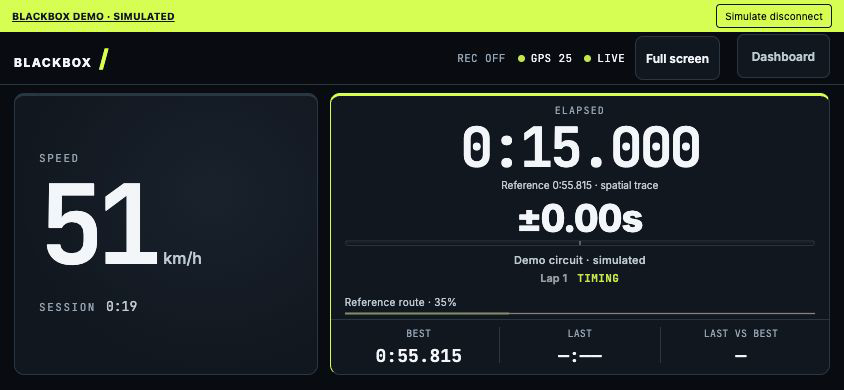

# Blackbox

**Understand your drive. Own the instrument.**

Blackbox is an open-source ESP32-C3 telemetry project: GPS and inertial sensing, circuit and stage timing, optional force analysis, and a phone-friendly dashboard served directly over local Wi-Fi. Rust firmware, inspectable maths, and browser-local recordings—no cloud account required.

[Project website & USB installer](https://jctoledo.github.io/blackbox/) · [Lap timer guide](docs/LAP_TIMER.md) · [Sensor fusion](docs/SENSOR_FUSION.md) · [Hardware checklist](docs/HARDWARE_VALIDATION.md) · [Try the demo](https://jctoledo.github.io/blackbox/demo.html)

[](LICENSE)
[](https://github.com/jctoledo/blackbox/actions/workflows/ci.yml)

### What it does

- Shows speed, longitudinal/lateral acceleration, driving mode, and sensor health.
- Records circuits or point-to-point stages and arms direction-aware GPS start/finish lines.
- Interpolates crossings between fresh fixes; preserves completed lap results across missed browser polls.
- Records telemetry in the browser and exports CSV; streams binary v4 telemetry to desktop tools.

### Why build Blackbox?

Own the instrument from sensor input to exported recording. Configure a NEO-M9N for a 25 Hz GPS target (or NEO-6M for 5 Hz), configure WT901 output up to 200 Hz, and inspect the actual delivered rates in Diagnostics. Time circuits and stages with interpolated GPS crossings, compare pace against a position-matched reference, and keep portable CSV/JSON backups. No project subscription or cloud account is required.

These are concrete capabilities and configuration targets. Measured timing accuracy is a separate question. See the [capability and paid-product comparison](docs/COMPARISON.md) for RaceBox, RaceChrono Pro, and Performance Box Touch, including where their packaged hardware and analysis workflows offer more.

### Project status

Active development. Automated physics, crossing replay, protocol, and browser regressions cover known failures; they do not establish real-world timing accuracy. The published firmware release can lag `main`. Read the release notes and choose the GPS model/rate that matches your hardware. The current estimator uses a diagonal covariance approximation; it is not a navigation-grade full covariance EKF.

## Quick Start

### Option A: Flash a published release from your browser

1. Go to **https://jctoledo.github.io/blackbox/**
2. Connect ESP32-C3 via USB
3. Select Blackbox and wait for the firmware checksum to verify.
4. Click **Connect device**, select the ESP32-C3 port, then **Flash firmware**.
5. Press RESET or reconnect USB after installation.

The installer writes a complete merged image at address `0x0`, including the device configuration area. It does not erase recordings stored in your browser. The download is served by this project’s Pages site, with SHA-256 verification before writing.

*Use desktop Chrome or Edge with Web Serial. If connection times out: hold BOOT, tap RESET, release BOOT, and retry. Close other serial monitors. See the release notes before installing.*

### Option B: Build from Source

```bash
# Install toolchain (one-time)
curl --proto '=https' --tlsv1.2 -sSf https://sh.rustup.rs | sh
cargo +stable install ldproxy --locked
cargo +stable install cargo-espflash espflash --version 4.7.0 --locked
rustup toolchain install nightly-2025-10-18 --component rust-src --component clippy

# Build and flash
cd sensors/blackbox
cargo run --release
```

First build takes 10-20 minutes. See [Build Guide](#building-from-source) for detailed instructions.

### Use the Dashboard

1. Power on device → creates WiFi network **"Blackbox"**
2. Connect your phone (password: `blackbox123`)
3. Open browser → go to `192.168.71.1`
4. Keep the unit still through calibration, then wait for a fresh GPS fix outdoors.
5. Select or record a track to arm timing. Cross its finite start line in the recorded direction; check the displayed state before a timed run.

---

## Hardware

### Required components

| Component | Role / compatibility |
|-----------|----------------------|
| ESP32-C3 development board | Controller and Wi-Fi; check the GPIO mapping below against your board |
| WT901 UART IMU | Acceleration, angular rate, and orientation; configure output rate and baud rate |
| u-blox NEO-6M or NEO-M9N | GPS; match the firmware build configuration to the receiver |
| WS2812 status LED | GPIO8 in this wiring; some boards include one |
| USB power and wiring | Use suitable voltage levels for your specific breakouts |

NEO-M9N supports up to 25 Hz, but that is an update-rate specification, not a lap-accuracy guarantee. Verify actual rates in Diagnostics. Parts prices and breakout-board capabilities vary.

### Wiring

**Check your board's USB wiring first.** This mapping assigns GPIO18/19 to the IMU UART. Those pins are also the ESP32-C3 native USB D−/D+ pins. Do not connect the IMU to them while also using that native USB connection; use a compatible USB-to-UART bridge or change the firmware pin mapping and wiring together. See [Espressif's serial-connection guide](https://docs.espressif.com/projects/esp-idf/en/latest/esp32c3/get-started/establish-serial-connection.html). A board marketed simply as “ESP32-C3” is not enough to establish compatibility.

```
ESP32-C3              WT901 IMU         GPS Module
─────────             ─────────         ──────────
3V3  ─────────────────► VCC
GND  ─────────────────► GND
GPIO19 (RX) ──────────► TX
GPIO18 (TX) ──────────► RX
3V3  ─────────────────────────────────► VCC
GND  ─────────────────────────────────► GND
GPIO4  (RX) ──────────────────────────► TX
GPIO5  (TX) ──────────────────────────► RX
GPIO8 ───► (Optional: WS2812 LED)
```

<details>
<summary><b>IMU Configuration (optional)</b></summary>

The WT901 ships at 10Hz. Firmware auto-detects baud rate, so **try it first without configuration**.

Check the diagnostics page — if IMU Rate shows ~10Hz instead of ~200Hz, configure it:

```bash
# Requires USB-serial adapter (~$5)
# Connect: IMU TX→Adapter RX, IMU RX→Adapter TX, GND, 5V
cd tools/python
pip install pyserial
python3 configure_wt901.py /dev/ttyUSB0
```

Settings save to EEPROM — only needed once per IMU.

</details>

---

## Mobile Dashboard

Connect to the device's WiFi and open `192.168.71.1` in any browser.

### Features

| Feature | Description |
|---------|-------------|
| Force analysis | Optional Analysis view with lateral/longitudinal forces and a motion trail |
| Speed | Current speed and session time |
| Landscape cluster | Rotate the phone for a speed-and-timing instrument layout; Dashboard returns to controls |
| Offline typography | Bundled Inter and JetBrains Mono match the demo without an internet font request |
| Mode Detection | IDLE, ACCEL, BRAKE, CORNER, or combined states |
| Driving Presets | Track, Canyon, City, Highway, or Custom |
| Lap Timer | Record tracks, time laps, compare against a saved reference |
| Recording | Capture sessions, export to CSV |
| Diagnostics | Sensor rates, GPS quality, EKF health |

### Controls

| Action | Effect |
|--------|--------|
| Tracks | Create/select a circuit or stage while parked |
| Record session / Stop recording | Capture or finish a browser-local recording |
| Saved data | Export CSV, download backups, restore copies and manage saved data |
| Analysis | Show optional force analysis |
| Drive view / Dashboard | Enter the focused display or return to controls |




---

## Lap Timer

Record tracks anywhere and get real-time lap timing with delta display.

**[Full Lap Timer Guide →](docs/LAP_TIMER.md)**

### Quick Overview

1. **Record a Track** — Open **Tracks**, choose circuit/stage recording, capture the route, then park safely to name and save it.
2. **Activate Track** — Tap saved track to enable timing
3. **Drive** — Cross start line, timing begins automatically
4. **Watch Delta** — Negative/green = ahead; positive/red = behind the saved reference

### Delta Bar

```
    -2.3s                     2.3 seconds AHEAD of reference
◄████████████░░░░░░░░►        Green bar extends left

    +1.5s                     1.5 seconds BEHIND reference
◄░░░░░░░░████████████►        Red bar extends right
```

- **Reference:** New position/time traces compare the same route location; old references upgrade after a clean lap/run. Ambiguous or stale matches hide delta. Historical best remains separate.
- **Scale:** ±2 seconds = full bar. Number shows actual delta beyond ±2s.
- **Trend arrows:** ▲ gaining time, ▼ losing time
- **Glow effect:** Appears when delta exceeds 1 second

### Features

| Feature | Description |
|---------|-------------|
| Circuit & Stage | Loop tracks or point-to-point routes |
| Session History | All lap times saved and grouped by date |
| Track Auto-Detection | Notifies you when near a saved track |
| Data Management | Download full backups, restore new copies, export CSV, manage sessions |

See the [full documentation](docs/LAP_TIMER.md) for details on recording, delta calculation, and troubleshooting.

---

### Keep a backup outside the browser

Stop recording, then open **Saved data → Download backup**. Save the JSON file in Files/Downloads and copy it somewhere safe. To recover on another browser, choose **Saved data → Choose backup → Restore as new copies**. Recordings, tracks, reference traces, and lap history are included; existing data is preserved. Files include location history and are not encrypted. See the [backup/restore guide and limits](docs/FAQ.md#how-do-i-back-up-and-restore-everything).

## Calibration

Proper calibration is critical for accurate readings.

1. Mount device rigidly in final position
2. Park on level ground, engine **OFF**
3. Power on and **don't touch anything** during yellow LED (~10 seconds)
4. Wait for cyan pulse = ready

**Signs of bad calibration:** Mode triggers incorrectly, G-meter not centered when parked, non-zero acceleration when stationary.

**To recalibrate the boot accelerometer bias:** Park level, keep the mounted unit still and restart it. The force-display clear control only resets displayed peaks; it does not recalibrate the sensor.

---

## LED Status

| Pattern | Meaning |
|---------|---------|
| Cyan pulse (2s) | GPS locked, operational |
| Yellow fast blink | Waiting for GPS fix |
| Yellow pulses | Calibration in progress |
| Green blinks (boot) | WiFi ready |
| Red blink | Error (check wiring) |

---

## Building from Source

<details>
<summary><b>Prerequisites by Platform</b></summary>

**Ubuntu/Debian:**
```bash
sudo apt-get install -y git wget flex bison gperf python3 python3-pip \
  python3-venv cmake ninja-build ccache libffi-dev libssl-dev dfu-util libusb-1.0-0

curl --proto '=https' --tlsv1.2 -sSf https://sh.rustup.rs | sh
cargo +stable install ldproxy --locked
cargo +stable install cargo-espflash espflash --version 4.7.0 --locked
rustup toolchain install nightly-2025-10-18 --component rust-src --component clippy
```

**macOS:**
```bash
brew install cmake ninja dfu-util
curl --proto '=https' --tlsv1.2 -sSf https://sh.rustup.rs | sh
cargo +stable install ldproxy --locked
cargo +stable install cargo-espflash espflash --version 4.7.0 --locked
rustup toolchain install nightly-2025-10-18 --component rust-src --component clippy
```

**Windows:**
1. Install Visual Studio Build Tools, Python 3, Git
2. Install Rust via rustup-init.exe
3. Install the same pinned Rust toolchain and Cargo tools shown above. Native Windows has not been validated by this project; the automated build environment is Linux.

</details>

### Build commands and target

The checked-in toolchain is `nightly-2025-10-18`; the C3 target is `riscv32imc-esp-espidf`. The checked-in flash runner and release packager explicitly pass the root `partitions.csv`; the old partition setup helper is not required. The maintainer's automated builds and tests run on lat.

```bash
cd sensors/blackbox
GPS_MODEL=m9n GPS_RATE=25 cargo +nightly-2025-10-18 build --release --locked
GPS_MODEL=m9n GPS_RATE=25 cargo +nightly-2025-10-18 clippy --release --locked -- -D warnings
```

Host tests run separately from the repository root, targeting the pure Rust crates as shown in CONTRIBUTING.md. Do not build/test the whole workspace against a host target and expect ESP-IDF firmware to work.

### GPS Configuration

```bash
# Default: NEO-6M at 5Hz
cargo build --release

# NEO-M9N at 25Hz
export GPS_MODEL="m9n" GPS_RATE="25"
cargo build --release
```

<details>
<summary><b>Troubleshooting Build Issues</b></summary>

**"can't find crate for core"**
```bash
rustup component add rust-src --toolchain nightly-2025-10-18
```

**"linking with riscv32-esp-elf-gcc failed"**
```bash
# Check the ESP-IDF tool installation reported by esp-idf-sys.
# Re-run the build from sensors/blackbox with the pinned nightly toolchain.
```

**Permission denied on serial port (Linux)**
```bash
sudo usermod -a -G dialout $USER
# Log out and back in
```

**Build hangs**
```bash
# Inspect the build log and compare toolchain/dependency versions with CI.
# Avoid deleting shared toolchain caches as a first troubleshooting step.
cargo +nightly-2025-10-18 build --release --locked -vv
```

</details>

---

## Configuration Reference

### WiFi Modes

**Access Point (default)** — Device creates its own network. Best for mobile use.
```bash
cargo build --release  # No config needed
```

**Station Mode** — Device joins your network. Enables UDP streaming to laptop.
```bash
export WIFI_MODE="station"
export WIFI_SSID="YourNetwork"
export WIFI_PASSWORD="YourPassword"
export UDP_SERVER="192.168.1.100:9000"
cargo build --release
```

### Mode Detection Thresholds

Configure via dashboard presets or custom sliders:

| Preset | Accel | Brake | Lateral | Best For |
|--------|-------|-------|---------|----------|
| Track | 0.35g | 0.55g | 0.50g | Racing |
| Canyon | 0.22g | 0.35g | 0.28g | Mountain roads |
| City | 0.10g | 0.18g | 0.12g | Daily driving |
| Highway | 0.12g | 0.22g | 0.14g | Cruising |

<details>
<summary><b>EKF Tuning (Advanced)</b></summary>

Edit `EkfConfig` in `framework/src/ekf.rs` (the firmware module re-exports it):

```rust
const Q_ACC: f32 = 0.40;    // Process noise: acceleration
const Q_GYRO: f32 = 0.005;  // Process noise: gyro
const R_POS: f32 = 20.0;    // Measurement noise: GPS position
const R_VEL: f32 = 0.2;     // Measurement noise: GPS velocity
```

These are estimator tuning values; they do not directly tune the separate force-display filters. See the sensor fusion guide for units and limitations.

</details>

<details>
<summary><b>Diagnostics Metrics Explained</b></summary>

| Metric | Healthy | Meaning |
|--------|---------|---------|
| IMU Rate | Compare with configured output | Parsed accelerometer packets/sec; processed prediction rate may differ |
| GPS Rate | 5-25 Hz | Position fixes/sec |
| Position σ | Track trends | Heuristic estimator diagnostic, not a measured error bound |
| Velocity σ | Track trends | Diagonal model diagnostic |
| Bias X/Y | <0.5 m/s² | Learned accelerometer bias |
| HDOP | <2.0 | GPS quality (lower = better) |

**Troubleshooting:**
- IMU 0 Hz → Check wiring, run configure_wt901.py
- GPS 0 Hz → Check wiring, ensure sky view
- High bias → Check mounting and restart stationary on level ground

</details>

---

## Technical Overview

**[Full Sensor Fusion Guide →](docs/SENSOR_FUSION.md)**

### How Sensor Fusion Works

The system combines configured IMU output (up to 200 Hz) with GPS fixes (typically 5 Hz for NEO-6M or 25 Hz for NEO-M9N). Actual processing and reception rates must be measured:

1. **Predict** — available IMU samples advance earth-frame position and velocity; UART batches can coalesce samples
2. **Correct** — each new valid GPS fix updates position and velocity once
3. **ZUPT** — When stopped, velocity forced to zero, biases learned

**7-state estimator with diagonal covariance:** Position (x,y), heading, velocity (vx,vy), accelerometer biases (bax,bay)

### Data Flow

```
GPS (5-25Hz) ──┐
               ├──► EKF ──► Mode Classifier ──► Telemetry (~30 Hz target)
IMU (200Hz) ───┘
```

See the [full sensor fusion documentation](docs/SENSOR_FUSION.md) for details on coordinate frames, ZUPT, EKF tuning, and diagnostics interpretation.

### File Structure

```
blackbox/
├── docs/                # Documentation
│   ├── LAP_TIMER.md     # Lap timer user guide
│   └── SENSOR_FUSION.md # EKF and sensor fusion details
├── framework/           # Sensor fusion library (host-testable)
│   └── src/
│       ├── ekf.rs       # Extended Kalman Filter
│       ├── transforms.rs # Coordinate math
│       ├── mode.rs      # Mode detection
│       └── fusion.rs    # GPS/IMU blending
├── sensors/blackbox/    # ESP32 firmware
│   └── src/
│       ├── main.rs      # Main loop
│       ├── websocket_server.rs  # HTTP transport; UI in web/dashboard.html
│       └── ...
└── tools/
    ├── dashboard-dev/   # Historical simulator (not production)
    └── python/          # Receivers and tools
```

---

## Python Tools

Station mode only. Connect ESP32 and laptop to same network.

```bash
cd tools/python
pip install -r requirements.txt

# Receive telemetry
python3 udp_telemetry_server.py

# Analyze CSV export
python3 analyze_telemetry.py recorded_session.csv

# Configure IMU
python3 configure_wt901.py /dev/ttyUSB0
```

---

## Future Enhancements

- [ ] SD card logging
- [ ] CAN bus integration
- [ ] Bluetooth connectivity
- [ ] Over-the-air updates
- [x] ~~Mobile dashboard~~ ✓
- [x] ~~High-rate GPS~~ ✓
- [x] ~~Lap timer~~ ✓

---

## Contributing

Contributions welcome — bug fixes, new features, documentation improvements. Open an issue or PR on GitHub.

## License

MIT License — see [LICENSE](LICENSE).

---

**Questions?** Open an [issue](https://github.com/jctoledo/blackbox/issues).

**Ready to build?** [Start with Quick Start ↑](#quick-start)

Website background footage is separately licensed and credited in [media provenance](docs/assets/README.md); the MIT license applies to project code.


### Phone display and horizontal mount alignment

Tap **Full screen** on supported Android browsers. On iPhone, use **Menu → Phone setup** for Safari's Home Screen steps. Back up saved data before changing browsers or launch mode; storage may be separate. The landscape layout follows orientation without changing timing or recording.

**Menu → Mount alignment** offers experimental horizontal mounting calibration with signed GPS braking evidence, candidate review and persistent save while parked. It changes force axes, not timing-line direction. Read the [alignment guide](docs/CALIBRATION.md) and validate signs on your device before relying on the result.
