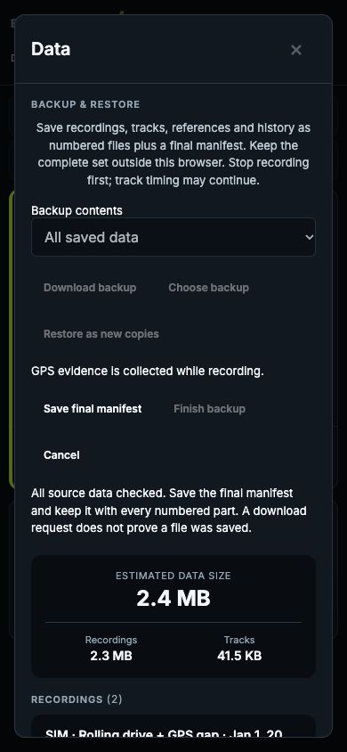

# Keep your Blackbox data safe

Recordings and tracks live in the browser that captured them, on the Blackbox origin. Clearing website data, switching browsers, changing the device address, or browser eviction can make that local data unavailable. Keep an external backup before making those changes. CSV is useful for analysis but cannot restore recordings or tracks.

## Make a multipart backup

Park and stop session and route recording. Open **Saved data**, choose the contents, then prepare the backup. A selected track may stay selected; a device connection is not required.

Save each numbered part when prompted. Keep every part and the final manifest together, preferably in a folder named for the drive. The manifest is offered last, after Blackbox has checked that the source data stayed consistent. Without it, the exported set is incomplete. Each file is limited to 8 MiB; one long recording stays one recording across those files.

A download request does **not** confirm that Files or Downloads saved the file. Check that all the files arrived and copy the complete set outside the browser, ideally to another device or your own backup storage. Blackbox does not automatically upload, encrypt or delete your data. These files contain location history.

You can cancel without changing your recordings or tracks. Without the final manifest, files downloaded before cancellation are an incomplete set; restart the export and keep only a complete set with its matching manifest. If source data changes during export, Blackbox refuses to finish the manifest. Stop timing/editing in other tabs and restart. Do not combine files from different attempts.

Export reads saved chunks in bounded steps, including a captured unsaved recording tail without requiring another storage write. It does not consume that tail. There is no whole-recording array or whole-archive Blob. Working memory still includes a part, the largest supported logical record, metadata and the pending tail; this is not a fixed total-heap or phone-capacity guarantee.

The final-manifest step in the actual dashboard, shown with synthetic demo data:

## Restore new copies

Choose the manifest and all its numbered parts in **Saved data**. Selection order does not matter. Keep the originals until you have checked the restored recordings and tracks.

Blackbox checks file identities, lengths, checksums, fragment order, record relationships and saved Drive evidence before writing to the recording or track databases. Invalid or incomplete files cannot begin promotion. Validation uses separate temporary browser storage, so restoration needs free space for staging and the new copies. A storage estimate is advisory; quota can still fail during writing.

Restore adds fresh IDs and remaps references and lap history together. Existing recordings and tracks are never replaced. New recordings are stopped and restored tracks are not automatically selected or armed. Recording does not resume automatically. Missing historical metadata stays unknown instead of borrowing details from the currently connected device.

Recordings and tracks are separate databases. Each group commits atomically; the pair is not one transaction. If recordings commit and the track group fails, the interface reports partial completion. Retry the remaining group rather than starting another import. Validated multipart staging and the ID mapping persist so an interrupted job can be recovered after reload. An ambiguous or conflicting result stops safely instead of guessing that it succeeded. Cancelling or discarding temporary staging never deletes original data or copies already committed.

A separate fresh import intentionally creates another set of copies. Do not use that as a retry for an unfinished job.

## Format limits

The multipart format supports at most 4,096 parts, 1,000,000 logical records, and 10,000 recordings and tracks each per archive. Each logical record (one stored chunk, track, reference or metadata row) must serialize to at most 16 MiB. A recording can be much larger because it contains many chunks. An individual oversized record is refused with the original intact; it is not truncated. Up to 100 staged restore jobs can be retained; discard completed or incomplete temporary staging explicitly to free space for another job. Blackbox never automatically deletes an older job to make room. These are format guards, not a promise that a phone has enough storage for the maximum archive. Restore needs temporary staging space as well as the new copies.

## Older backups

Version 1 single-file Blackbox JSON backups remain importable, with the existing 100 MiB per-file limit. Legacy version 2 track JSON exports, single or bundled, remain importable too. Their format version belongs to track exports and is distinct from the multipart backup version. Those legacy track files have no original checksum. CSV and version 1 track exports cannot be restored through this flow.

The older single-file restore keeps its retry plan only in the open tab. If it partially completes, use **Retry remaining data** before reloading. After reload, inspect Saved data before starting another import to avoid duplicate copies.

## Check recovery before you rely on it

On a destination browser, restore a test copy and compare recording/GPS row counts, recording details, track names, reference traces and lap history. Reload and check the stopped or interrupted Drive context and recalculated Summary. A backup is useful only when you can recover it.

Actual Android and iPhone acceptance is tracked in [#153](https://github.com/jctoledo/blackbox/issues/153): downloading several files, selecting the complete set, quota handling, cancellation, and reloading during a restore. See the [phone acceptance checklist](HARDWARE_VALIDATION.md#drive-recording-and-backup-acceptance-on-both-phones). Synthetic tests on lat establish software behavior, not phone memory capacity or protection from a device failure before files have been saved externally.

CRC checksums detect accidental corruption; they do not authenticate the author or defend against a deliberately forged file. Maintainers can inspect the [format and recovery protocol](BACKUP_FORMAT.md). The implementation relies on the standard [File API](https://www.w3.org/TR/FileAPI/) and [IndexedDB transactions](https://www.w3.org/TR/IndexedDB/), with ordinary file downloads and selection on HTTP. It does not require the File System Access picker.
