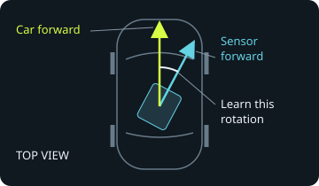
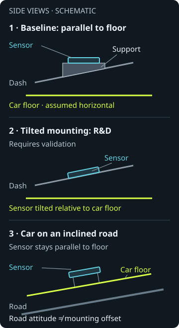

# Align sensor to car (experimental)

Mount alignment learns the vehicle's forward axis relative to an upright, nearly level device. It changes force projection and the associated orientation-feedback axes. It does not change GPS coordinates, timing-line direction, or the EKF's device-heading basis. This is a software-tested candidate workflow; physical alignment accuracy is not established.

## What is being aligned?

Blackbox needs to know **the car’s forward direction relative to the mounted sensor**. If the sensor is rotated left or right on its mounting surface, its own X/Y axes do not automatically mean car-forward and car-right. Alignment teaches the software that rotation so acceleration, braking and left/right forces use the car’s frame.

This is horizontal rotation, viewed from above. It does not point the GPS north, set a timing line, level the sensor, or compensate for a sloping road. Startup accelerometer-bias calibration is a separate stationary step.

## Sloped mounting surfaces are R&D

The baseline setup is a rigid, upright sensor parallel to the car floor, nearly
level when parked on level ground. Verify acceleration/braking and turn signs in
that installation. Non-horizontal sensor mounting remains R&D requiring physical
validation; the software fixes do not expand the normal mounting contract.

On a sloping dash, use a rigid support or wedge to keep the sensor parallel to
the car floor. A driveway incline tilts the whole car; it does not change the
sensor-to-car mounting offset. Prefer level ground for the initial baseline
checks and keep the car motionless during startup.

Perfect mechanical flatness is not required by the gravity/acceleration equations.
Firmware derives distinct heading and planar angular evidence from all three gyro
axes and removes predicted gravity for stationary detection. This makes the
software consistent under ordinary vehicle pitch/roll and gives tilted-mount
experiments a better basis. It does not establish an accurate mounting angle.
Vertical, inverted and arbitrary three-dimensional installations are not supported
by the horizontal alignment workflow.

A mounting slope is fixed relative to the car; road grade/bank changes the car's
attitude relative to earth. AHRS attitude contains both and does not identify them
independently. Alignment does not recover the complete sensor-to-car rotation or
produce slope-corrected performance measurements. The startup ±20° and alignment
±10° gates are collection heuristics, not validated physical mounting tolerances.

A dash or hood location also needs checks for magnetic disturbance, vibration,
heat, enclosure suitability and a rigid attachment in that actual installation.
No accuracy claim follows from location alone. See [physical acceptance](HARDWARE_VALIDATION.md).

## Use it

1. Park on level ground and secure the sensor parallel to the car floor and nearly level; boot motionless for the separate IMU bias calibration. Wait outdoors for fresh GPS and a stationary indication.
2. Open the dashboard menu → **Align sensor to car**. Start while parked. The device must have writable NVS storage.
3. At a controlled site, drive **forward**, then brake steadily in a straight line. Do not interact with the phone while moving. The screen does not tell the driver when to perform a sudden maneuver.
4. Park and review the candidate. **Use this alignment** writes it before activating it. A failed write leaves the previous offset active and permits retry. **Cancel attempt** discards the candidate. **Reset alignment** restores the default axis assumption while parked.
5. Verify acceleration/braking and left/right force signs against known motion. Repeat after remounting. Keep recordings and mounting photos for review.

The operator must establish forward travel. Scalar GPS speed and a brake vector cannot independently distinguish braking while reversing: that can yield a 180° error. Slopes, banking, sensor latency, AHRS errors and valid-looking GPS outliers remain field-test cases. The current collection gate rejects more than 10° measured roll/pitch; this is a heuristic, not slope compensation.

## Driveway slopes and startup bias

The startup/recalibration candidate now subtracts the gravity vector predicted by fresh WT901 roll/pitch before estimating sensor bias. Earlier builds assumed gravity lay along sensor Z; a 3° incline could be learned as about 0.052 g of false horizontal bias. The revised arithmetic handles modest inclines in synthetic tests, but depends on the AHRS attitude estimate and still needs driveway tests on the actual hardware.

It accepts only finite samples with gyro/attitude ages at most 200 ms, rotation below 0.03 rad/s, roll/pitch within 20°, acceleration magnitude within 1 m/s² of gravity and each gravity-removed residual within 0.6 m/s². Rejected evidence resets collection. A maximum 100 Hz collection rate gives 150 samples at least approximately 1.5 seconds of coverage; residual standard deviation above 0.15 m/s² rejects the result. The 30-second timeout remains. These are conservative heuristics, not proof that the vehicle is stationary.

A single pose cannot independently distinguish every sensor bias, attitude error and sustained acceleration. Keep the vehicle still, prefer level ground for the initial physical checks, and do not treat this as slope correction for performance runs. Menu recalibration replaces the previous bias only on success; startup refuses to complete after calibration failure. Horizontal mount alignment remains a separate workflow.

## Evidence and gates

Only new valid GPS fixes after warmup contribute, paired with a recently received IMU acceleration sample (≤60 ms) and gyro/angle packets (≤200 ms). GPS host-receive intervals must be 20–300 ms. Signed speed change must be between −10 and −1.5 m/s², with a compatible horizontal IMU magnitude. Earth-vertical gyro projection and GPS-course gates require approximately straight motion; this remains a planar approximation. At least 0.6 seconds and four independent qualifying GPS samples are required; duplicate samples, gaps, interrupted braking and inconsistent directions cannot complete early. An attempt expires after 60 seconds even if sensors stop.

These thresholds support the project's 5 Hz and 25 Hz configurations; packet coalescing and noise can cause a conservative rejection. Rate targets do not establish delivered rates or time synchronization. No EKF-derived speed is used to prove braking, avoiding circular evidence from the IMU being calibrated.

## Frames and persistence

Gravity is removed in body coordinates; roll/pitch are levelled before finding the brake direction. The candidate is the circular mean brake angle plus π. With offset θ meaning vehicle-forward measured counterclockwise from levelled device X, vehicle vectors use `R(−θ)`. Force projection uses device yaw + θ; the original device yaw is retained for body-to-earth transforms. Tilt-feedback residuals are rotated back into device axes before adjusting device pitch/roll.

Saving resets learned force-fusion corrections so old mounting-dependent biases do not carry over. A single 16-byte versioned NVS value contains the offset, enabled flag and CRC32. The prior PR's separate `mount_off` / `mount_ok` keys are intentionally not trusted or migrated. Invalid records fall back to an unset offset. The CRC detects corruption; it is not authentication. Actual flash power-loss behavior still needs hardware testing, and a full merged firmware installation may replace NVS configuration.

## Software regressions and physical acceptance

Regressions cover multiple mount angles, both receiver cadences, wrapped clocks, acceleration-versus-braking, missing/stale/nonfinite data, early interruption, sticky failures, persistence failure/retry, corrupt records, vehicle-force projection and orientation-feedback convergence after rotation. See [hardware acceptance](HARDWARE_VALIDATION.md) for the remaining checks.

The workflow revises Adam Weber's brake-vector mounting proposal in PR #13. The original magnitude-only detector and heading-offset integration are not used.
