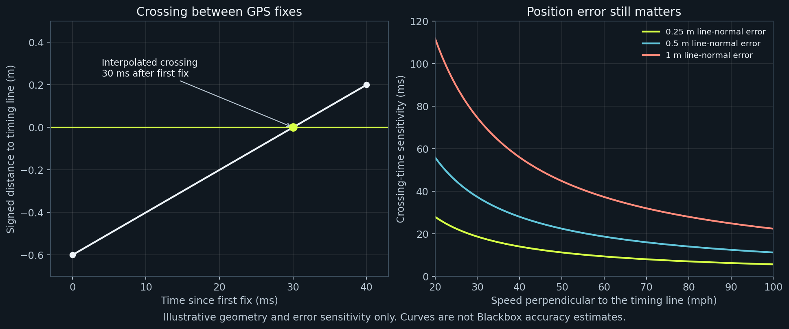
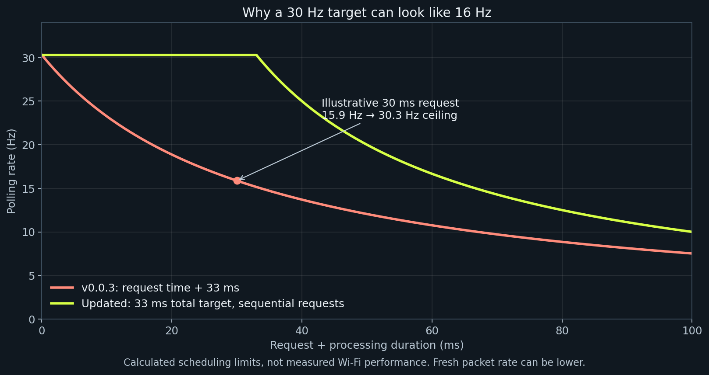

# How Blackbox works

Blackbox turns a small sensor box and a phone into an instrument for your drive. It can time a circuit or a point-to-point stage, compare your pace with a saved reference, show estimated forces, and preserve the evidence for review afterwards. The appeal is ownership: you can inspect how a number was produced, change the software, and keep your recordings without a project subscription.

The useful question is not simply “how fast does it update?” It is **what does each number mean, and when should you trust it?** This guide follows a measurement from the car to the screen.

[Try the dashboard](https://jctoledo.github.io/blackbox/demo.html) · [Build the hardware](BUILD.md) · [Equations and rate budgets](MATHS_AND_RATES.md)

[TOC]

## One box measures. Your phone explains.

The current firmware targets an ESP32-C3. A u-blox GPS receiver supplies position, speed, course and receiver timestamps. A WT901 inertial sensor supplies acceleration, angular rate and attitude. The controller reads both over separate serial connections, estimates motion, detects timing-line crossings, and serves the dashboard over local Wi-Fi.

The phone is the display and recording store. It compares your current route position with a saved reference and writes recordings to its browser database. It does not need a cloud connection to show the device dashboard.

| Part | Its job | Why it matters |
| --- | --- | --- |
| GPS | Position, velocity and time evidence | Anchors the route and provides the observations used for crossings |
| IMU | Acceleration, rotation and attitude | Adds motion information between GPS updates; helps estimate forces |
| ESP32-C3 | Sensor processing, lap/stage timer and local web server | Timing continues on the controller when the browser connection pauses |
| Phone browser | Instruments, reference matching, recording and exports | Your saved sessions live here; a disconnected or suspended browser can miss data |

That split has a practical consequence: losing Wi-Fi is different from losing GPS. A lap may finish on the controller while the phone is disconnected, but the phone cannot reconstruct every missed telemetry sample afterwards.

### Batched GPS evidence and missing data

The UART reader can receive several RMC sentences during one poll. Timing now replays a bounded queue of individual fix snapshots rather than using only the last parsed position. Invalid fixes remain in that evidence stream so a valid-invalid-valid batch cannot silently bridge the invalid segment. Queue overflow breaks continuity before the retained tail is replayed.

Each snapshot uses its host sentence-completion time. Stale/future evidence, long gaps and timestamps that collapse into the same millisecond invalidate interpolation continuity. The implementation does not spread buffered fixes across invented receiver times; receiver-epoch/PPS synchronization remains future work. These checks fix software evidence handling, while physical missed-crossing rates still need reference tests.

## A lap starts at a line, not at a screen refresh

You define a finite timing line across the route and its allowed crossing direction. A circuit uses the same line for start and finish. A stage uses separate start and finish lines. The timer looks for the segment between consecutive fresh GPS positions to intersect that line. Direction, minimum speed, plausible movement, continuity and duration checks reject several common false triggers.

The crossing usually falls between observations. Blackbox estimates its time by interpolation. If the two fixes are 0.6 m before and 0.2 m after the line, the crossing is three quarters of the way through that interval. With fixes 40 ms apart, that is 30 ms after the first fix:

```
fraction = 0.6 / (0.6 + 0.2) = 0.75
crossing time = first time + 0.75 × 40 ms
```



This is better than assigning every crossing the time of the next observation, but interpolation cannot remove an erroneous position or variable receiver latency. The current lap timer uses host timestamps associated with the fixes, not a 200 Hz predicted trajectory. A missed crossing during a GPS outage must remain missing rather than becoming an invented lap.

A useful approximation is **timing error ≈ position error perpendicular to the line ÷ speed perpendicular to the line**. A hypothetical 1 m error at 20 m/s corresponds to 50 ms. A shallow crossing angle makes that sensitivity worse. This example explains the geometry; it is not a measured Blackbox accuracy figure. See [line setup and troubleshooting](LAP_TIMER.md).

## Delta answers “am I ahead at this place?”

A faster or wider path can cover a different distance. Comparing equal distance travelled would then compare different places on the route. Blackbox instead saves a reference containing positions and elapsed times, matches the current position to that route, and compares elapsed time there.

A negative delta means ahead of the reference; positive means behind. Route progress is the matched distance along that reference divided by its total length. It is an estimate of how far through the lap or stage you are, not a precisely known vehicle position.

The matcher checks freshness, travel direction and continuous progress. If two nearby route branches compete, or the car leaves the reference route, it suppresses the comparison. That is preferable to a persuasive number attached to the wrong corner. Automatic turn identification and turn-by-turn coaching are still research work.

## Why combine GPS and an IMU?

GPS gives an external anchor, but measurements arrive at discrete times and contain error. Integrating an IMU provides continuity, but a small acceleration bias grows into velocity and position error. The estimator combines the two instead of treating either as perfect.

Its seven states are horizontal position, heading, horizontal velocity and two acceleration biases. The prediction follows familiar motion equations:

```
new position = position + velocity × dt + ½ × corrected acceleration × dt²
new velocity = velocity + corrected acceleration × dt
new heading  = heading  + yaw rate × dt
```

GPS observations then correct the predicted state. The implementation retains per-axis position/velocity/bias covariance, with independent yaw. This lets receiver corrections estimate earth-frame acceleration bias while moving. Yaw-to-translation and ENU cross-axis correlations remain omitted. Diagnostic uncertainty is useful for inspecting behaviour; it is not a calibrated physical accuracy certificate. The [maths guide](MATHS_AND_RATES.md) covers propagation, units and the approximation, and the [sensor-fusion guide](SENSOR_FUSION.md) describes the implementation.

## What the G-meter is showing

The display estimates acceleration in the car's frame. Longitudinal force combines filtered inertial information with changes in GPS speed. Lateral force uses a centripetal model based on speed and corrected yaw rate:

```
lateral acceleration ≈ speed × yaw rate
g-force estimate = acceleration / 9.81
```

At 20 m/s and 0.25 rad/s, the model gives 5 m/s², or about 0.51 g. Banking, pitch, sideslip, sensor delay and imperfect attitude estimates can change the relationship to real tyre and body forces. This is not a direct grip measurement.

A fixed selectable scale makes the trace comparable through a manoeuvre. Its short history shows the transition from braking into a corner and back to acceleration. Stale GPS or IMU packets clear live force readings. Peaks uses the strongest **half-second averages ending at retained samples** while moving, so one isolated spike does not become an instantaneous record; it still cannot reject every plausible sensor error.

The sensor also needs to know which way the car points. **Align sensor to car** learns the horizontal rotation between the mounted sensor and the vehicle. Startup bias calibration is a separate operation that estimates stationary sensor offsets using an attitude-based gravity subtraction. Read the [illustrated alignment guide](CALIBRATION.md), including the remaining incline tests.

## Rates are different from accuracy

The M9N release configuration targets 25 GPS updates per second; the NEO-6M variant targets 5. WT901 output can be configured up to 200 Hz, but sensor output, processed samples, force fusion, telemetry and browser rendering are separate rates. The force/telemetry path is approximately 30 Hz, and actual delivered rates must be measured.

At 60 mph the car moves about 1.07 m in a 40 ms GPS interval. That does not impose a 40 ms timing quantisation because crossings are interpolated, and it does not promise a particular timing error either. Antenna reception, geometry, clocks and processing still matter.



The older dashboard waited another 33 ms after a request completed. A 30 ms request therefore produced about 16 updates per second. The revised scheduler counts request time inside that budget. Roughly 30 Hz is a scheduling target, not a promise that every phone and Wi-Fi link will sustain it. The [rate-budget walkthrough](MATHS_AND_RATES.md) separates all these layers.

## Other instruments, without hiding the evidence

Landscape keeps timing/reference, or the recording-backed Drive panel when no track is selected, in place while the other panel switches between Speed, G-meter, Peaks and Runs. Tap the instrument name to reveal the picker or swipe horizontally; choosing a view hides the picker again. Speed includes a page-session maximum while GPS is fresh. Portrait brings setup and saved data back into reach. **Menu → Speed units** switches Speed and MAX between mph and km/h, chooses the corresponding Runs preset within its selected family, and remembers the preference in this browser. Exported units and the named 45–70 mph, 30–60 mph, 50–100 km/h and 80–120 km/h tests keep their existing definitions.

The G-meter's smoothing/trail age, page SESSION stopwatch and active route-capture elapsed display use monotonic browser time so phone calendar corrections cannot corrupt their intervals. SESSION starts with the page or a statistics reset; it is separate from the recording-owned Drive duration. A real motion-frame gap over 250 ms clears the filter/trail history. Raw recording receipts and track-point timestamps retain their original calendar values, including clock corrections. This does not guarantee elapsed accuracy or recording while the phone sleeps or suspends the browser.

Runs currently estimates rolling **45–70 mph, 30–60 mph, 50–100 km/h and 80–120 km/h** intervals from receiver timestamps, not browser arrival times. It interpolates threshold crossings and rejects gaps, restarts, turns and incomplete attempts. It has no slope correction or distance rollout. Standing-start 0–60 mph needs its own validated launch rule and is not implemented. Read [the timing rules and export format](RUNS.md).

The website demo uses the same dashboard HTML as the device, with simulated input. Its circuit model anticipates braking for curvature and limits corner-exit acceleration; it is not a vehicle-dynamics validation or a recorded performance result. The discreet SIM marker remains visible. The circuit includes left and right bends, and its startup summary uses a simulated lead-in. Saved data contains clearly named circuit and rolling-interval examples. The rolling example includes two accepted intervals and one rejected by a deliberate six-event GPS gap, so you can inspect exports and try backup/restore without inventing a result. These example recordings are added once per demo dataset version; existing recordings are preserved.

With no track selected, the Drive panel gives an ordinary recording its own purpose: duration, partial receiver-speed GPS distance and data health. Stop freezes the metrics before final network/storage waits. Distance excludes the initial GPS snapshot and unsupported intervals instead of filling gaps. [Drive recording](DRIVE.md) explains the enrollment fences and clocks.

## Your recordings should survive your next experiment

Sessions, tracks, references and lap history stay in browser storage. Session CSV preserves ordinary telemetry; GPS CSV preserves receiver epochs, host parse times, sequences and visible gaps. Runs CSV derives accepted and rejected attempts from that evidence. A full JSON backup can be previewed and restored as new copies. **Saved data → Summary · saved samples** derives maximum qualified speed and strongest sample-ending half-second acceleration, braking and left/right force estimates from committed chunks. Pending data is excluded until saved; missing legacy quality remains unavailable. This saved Summary is separate from live page-session MAX/Peaks, and [details JSON](RECORDING_SUMMARY.md) includes its versioned SI values and supporting counts.

Local storage is convenient, but it is not an external backup. Browser eviction, private browsing, changing phones and clearing site data can remove it. Keep the dashboard foregrounded while recording, stop while parked, and export a backup before changing browsers or devices. See [backup and restore](FAQ.md#how-do-i-back-up-and-restore-everything) and [GPS drive-data analysis](GPS_LOGGING.md).

## Build it, then measure it

Blackbox is useful as an inspectable enthusiast instrument: circuit/stage timing, reference pace, force trends and portable recordings in a system you can modify. Packaged products may offer validated timing performance, standalone storage, video integration or support that this DIY build does not establish. The [sourced comparison](COMPARISON.md) makes those trade-offs explicit.

Software tests can verify equations, crossing cases, parser behaviour and recovery failures. They cannot establish physical timing accuracy, antenna performance or mount quality. Start with [the build guide](BUILD.md), then use [the hardware checklist](HARDWARE_VALIDATION.md). A normal drive can reveal dropouts, noise and recording problems; an independent crossing reference is needed to measure lap-time error.
