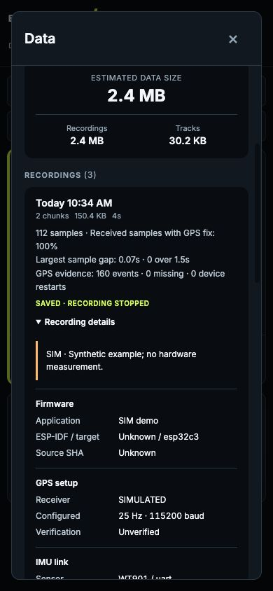

# Your first Blackbox drive: capture useful evidence

Start with an ordinary drive after the bench checks. The aim is to establish that your NEO-M9N installation produces interpretable, recoverable data. No hard acceleration, braking tests or timed public-road driving is needed.

## Before you leave

- Download a full backup of existing browser recordings and tracks. Keep it outside browser storage.
- Confirm the controller is the supported ESP32-C3 build and choose the NEO-M9N release image. Record the version and checksum. Check the actual board's USB arrangement before attaching the IMU; the default GPIO18/19 UART assignment conflicts with active C3 native USB.
- Secure the enclosure, antenna, wiring and phone. Photograph the sensor axes and antenna position while parked. Configure the UI before driving.
- Use level ground for the first stationary startup baseline. The modest-incline arithmetic has software tests; a driveway comparison is a later parked validation step.
- Choose one phone/browser as the primary recorder. Keep that dashboard foregrounded, powered and unlocked. A Home Screen launch may use different browser storage; test recovery before relying on it.

## Parked, outdoors

1. Wait for fresh GPS. Capture Diagnostics showing delivered GPS/IMU rates and satellite information. A 25 Hz firmware target is not a delivered-rate result.
2. Press **Record session** and confirm REC. Record roughly two minutes stationary, giving us a baseline for speed/forces and receiver cadence.
3. Check that data is saving. Do not clear an unfinished-recording notice by deleting storage; Saved data contains the retained chunks.

## During the ordinary drive

Leave the interface alone. Changing Speed/G-meter/Peaks/Runs does not control which data is recorded or which rolling detectors run. Missing interval results are normal if an ordinary trip never supplies the required thresholds and lead-in evidence.

A nearby saved track may appear in a separate suggestion row. It does not arm timing or start recording. **Dismiss** suppresses that track until this page reloads; an untouched suggestion expires and waits before returning. Review or activate it while parked. Suggestions withdraw when GPS is stale or track setup changes.

A passenger may note approximate times of a disconnect, unexpected value or missed start. Otherwise make notes only after stopping. Keep the phone foregrounded; screen lock or background suspension can create collection gaps.

Recording a route and timing a stage are separate operations. For an initial long highway trip, ordinary session logging is enough. Controlled start/finish testing can follow after the basic capture is sound.

## Parked at the end

Record another short stationary segment. Stop recording, wait for saving, then open **Saved data**:

- Export the recording's **Session CSV** and **GPS CSV**.
- On **v0.0.4-rc.11 and later**, expand **Recording details** and choose **Download details JSON** for the recording. Keep this companion file with the CSVs and backup; rc.10 does not provide this capture/export. Pending or unavailable details do not prevent recording.
- Export **Runs CSV** if attempts exist. An empty result is not a failed ordinary drive.
- Download a **full backup**. Export track geometry too if you recorded or used a circuit/stage.
- Reload the same browser/origin and confirm the recording remains listed. Preserve the backup before trying another browser or phone.

Keep files together in a private folder named with date, receiver and firmware version. Keep the flashed image SHA-256 and add a short note: phone/OS/browser, antenna/mounting, foreground/background events, reception conditions and anything unexpected. Automatic recording context does not infer these details; its configured rates do not replace the delivered rates in Diagnostics. Retain originals; make redacted copies for public reports. CSV/JSON backups contain location history and are not encrypted.

## What to photograph

| Photo | Detail to preserve |
| --- | --- |
| Parts and wiring | Module identity, pin labels, connector routing and USB arrangement |
| Enclosure/mount | Sensor axes, car-forward direction, retention and strain relief |
| Antenna | Actual installed position and nearby obstruction |
| Parked phone display | Firmware, orientation and fresh sensor status |
| Diagnostics before/after | Delivered rates and changes during the trip |

Avoid credentials, home addresses, registration details and identifying paperwork in public images. The [build journal](BUILD.md) has space for selected photos; the [accuracy article](GPS_TIMING_ACCURACY.md) has a clearly pending measurement report.

## What we can learn

From this capture we can inspect receiver epoch cadence, host/phone gaps, reboots, nonfinite or stale data, parked residuals and recovery/export behavior. We can investigate timing failures if the relevant crossing and geometry were captured.

Absolute timing accuracy requires controlled repeated crossings and an independent reference with known uncertainty. Real-drive precision/recall for Runs requires labelled positive and negative examples, not just successful attempts. Those are later tests, described in the [full hardware checklist](HARDWARE_VALIDATION.md) and [Runs rules](RUNS.md).
