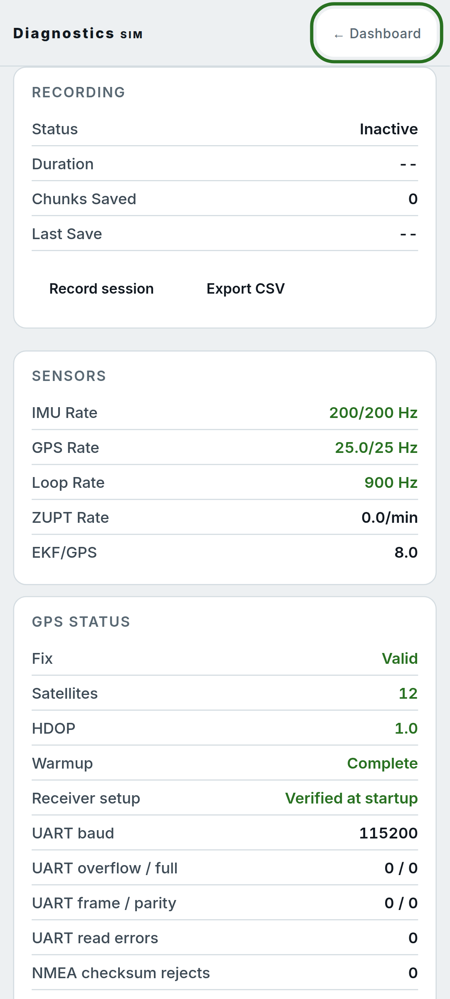
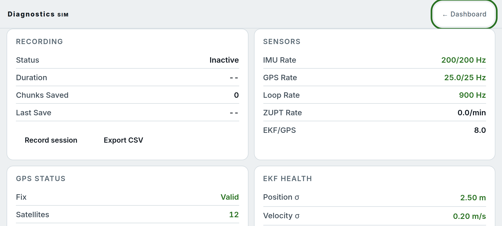

# GPS timestamp evidence for your drive

Use **Record session** while connected to the device. With firmware supporting `/api/gps-log`, the dashboard also collects a separate GPS event stream. After stopping while parked, open **Saved data** and download both **Session CSV** and **GPS CSV**, plus a full backup and your track/stage export. Older firmware can still record dashboard samples, but cannot provide this GPS log.

The GPS CSV is the useful new evidence for issue #55. It helps distinguish receiver cadence, duplicate epochs, UART/application batching and phone collection gaps. It does not establish absolute position or crossing accuracy.

## What is actually captured

Each checksum-valid GPRMC/GNRMC sentence gets a sequential event at the point the UART polling code finishes parsing it. This includes invalid-status RMC messages, warmup samples and repeated UTC epochs. Invalid/unaccepted position fields are blank instead of repeating the previous position. Corrupt checksums, bytes lost before parsing, other NMEA sentences and raw IMU packets are not logged.

The device retains **512 events in RAM**: about 20.48 seconds at 25 Hz or 102.4 seconds at 5 Hz. Responses remain bounded to 64 events. The phone fetches once per second while recording and drains retained history using a boot/sequence cursor, removes duplicates and saves events in the same IndexedDB chunks as the recording. The initial fetch and clients without a cursor still receive only the latest 64 events. GPS events survive the existing backup, restore and interrupted-session recovery flows. No device flash logging or background-phone guarantee is implied.

A longer disconnect can overwrite the RAM window. The first recovered row counts missing sequence numbers in `missing_before`. Device restarts begin a new segment; the first row's missing history is unknown, not zero. The initial fetch may include up to 64 events from before you pressed Record. Compare device timestamps to Session CSV to select the recording interval. Each boot uses a random 32-bit identifier, a practical restart discriminator rather than a globally unique ID.

The updated dashboard uses nonblocking confirmations, track naming and notices.
GPS polling continues while a name or decision is pending. Park before editing;
leaving a dialog open does not stop recording or timing. This removes app-dialog
pauses, but cannot prevent phone suspension, network loss or every scheduling gap.
The bounded device window and explicit missing-event markers still apply.

## Recording context

In **v0.0.4-rc.11 and later**, the dashboard requests one device metadata snapshot when a new recording starts. Recording begins immediately while context is **pending**; valid details become **captured**, and an old endpoint, timeout or invalid response becomes **unavailable** without stopping collection. In **Saved data**, expand **Recording details** and choose **Download details JSON** to save a companion to Session/GPS CSV. This browser capture/export is not available in rc.10.

The snapshot records firmware/build identity when available, the device boot ID and assembly uptime, configured GPS/IMU settings, successfully applied accelerometer bias and saved/applied mount alignment. Configured rates and baud choices alone are not delivered-rate measurements; use Diagnostics and GPS CSV for delivery evidence. From rc.17, the M9N startup profile is ACK/readback-verified when `configuration_verified` is true; that is a startup observation, not continuous receiver verification. The accelerometer bias is in sensor axes, before mount alignment, and is separate from the estimator's learned earth-frame bias. Null means unknown; a known zero is a value. One snapshot describes its assembly time, not constant settings or calibration throughout the trip.

The dashboard preserves available context in version 2 multipart backups, restore copies and interrupted-recording recovery; older version 1 full backups remain importable. Older recordings/backups without context remain **unknown**; reopening or restoring them must not fill historical details from today's device. Demo details are explicitly **SIM** / simulated and must not be used as hardware evidence. See the [metadata API and browser contract](RECORDING_METADATA_API.md).

Keep manual phone/OS/browser, antenna, mounting and reception notes, plus the flashed image's SHA-256. An optional source commit is not an image checksum. Details JSON complements the CSVs and restorable backup; it does not replace them.

## GPS CSV fields

| Field | Meaning |
| --- | --- |
| `browser_received_ms` | Browser wall clock at batch receipt. Several GPS events share this value. Phone clock adjustments may change it. |
| `boot_id`, `rmc_seq` | Device boot discriminator and monotonically increasing event sequence within that boot. |
| `host_parse_us` | 64-bit device monotonic microseconds when the complete RMC was parsed. Not the first UART byte, antenna measurement instant or PPS edge. |
| `receiver_utc_us_of_day` | Receiver-reported RMC UTC with fractional seconds, represented as microseconds since midnight. Null/missing time exports blank. A reported 23:59:60 is retained beyond the ordinary day's range. |
| `receiver_date_ddmmyy` | The receiver's two-digit-year date as a numeric code. Pad to six digits when displaying it. No century/Unix-epoch inference is made. |
| `utc_fractional_digits` | Number of decimal digits supplied by the receiver. Finer than microsecond fractions are truncated. More digits do not mean greater accuracy. |
| `rmc_active`, `fix_accepted` | Receiver status A and parser acceptance after coordinate/speed validation and warmup, respectively. Neither proves absolute accuracy or a lap crossing. |
| `gps_lat`, `gps_lon`, `speed_mps`, `course_rad` | Accepted RMC position, speed in metres/second and course clockwise from north. Blank for unaccepted fixes. Ordinary telemetry has its own units and sampling cadence; older firmware preferred EKF speed, while the updated source prefers fresh GPS velocity. |
| `missing_before` | Missing parsed events since the preceding saved event in the same boot; blank at an initial/restart boundary. Does not count receiver output or UART bytes lost before parsing. |
| `boundary` | 0: continuation, 1: initial capture, 2: changed boot. |
| `synthetic` | 0: device logger; 1: synthetic website demo. Never mix demo rows with driving evidence. |

Session CSV gains `gps_boot_id`, `gps_rmc_seq`, `gps_host_parse_us`, `gps_receiver_utc_us_of_day`, `gps_receiver_date_ddmmyy`, and `gps_utc_fractional_digits` for the latest parsed RMC accompanying each dashboard sample. A repeated sequence is a repeated snapshot, not another receiver fix. The existing `device_time_ms` wraps at 2³² milliseconds; use the full-width GPS host time and boot boundaries when aligning logs.

The historical Session CSV name `ekf_yaw` holds the packet's **display heading**, in clockwise compass basis, with a learned GPS reference offset when available. It is not the estimator's internal counterclockwise mathematical yaw. Its absolute reference is unverified before alignment; the CSV field does not carry an alignment-valid flag. Keep firmware identity when comparing files: the heading basis correction after rc.12 fixes opposite turn sense during turns, without recalculating older recordings.

## Analyze without publishing your route

For the ordinary **Session CSV**, run:

```sh
python3 tools/python/analyze_telemetry.py blackbox_session_YOUR_SESSION.csv
```

This streams a versioned JSON observation report: browser intervals, same-boot device intervals, duplicates/reversals/gaps, sample provenance, GPS/IMU freshness exclusions, qualified speed in km/h and individual force estimates in g. It emits no filename, coordinates or absolute timestamps. Missing legacy quality stays unknown; speed/force statistics require the stated freshness gates. Counts are sample counts, not time shares. Device intervals include gaps; browser clock changes are counted instead of becoming a recording duration. These individual force statistics differ from the saved Summary's sustained half-second Peaks.

The former script's dashboard-speed "ground truth", classifier precision/recall, calibration judgements and threshold recommendations have been removed. Repeated receiver snapshots, phone timing and correlated estimates cannot establish those conclusions. A single sample or an empty export now produces null interval statistics rather than an exception. Preserve raw CSVs privately; sharing a reduced report still reveals driving statistics.

For the separate **GPS CSV**, run:

```sh
python3 tools/python/analyze_gps_timestamps.py blackbox_gps_YOUR_SESSION.csv
```

The tool emits JSON with receiver and host interval summaries, duplicate/backward epochs, detected log gaps, invalid fixes, boot segments and closely batched arrivals. It prints no coordinates. Interval differences remove a constant clock offset but still mix delivery jitter and clock drift; they are not one-way latency measurements. Date transitions are excluded instead of guessing midnight/leap-second alignment. Preserve the original files and report failures alongside successful intervals.

For the weekend: capture a few minutes parked outdoors, your ordinary drive and another parked segment. Keep the dashboard in the foreground. Export before changing browsers/Home Screen installations. Keep precise route files private. Independent timestamped crossing evidence is still needed to assess lap accuracy.

Protocol reference: [u-blox M9 SPG 4.04 interface description, RMC section 2.7.16](https://content.u-blox.com/sites/default/files/u-blox-M9-SPG-4.04_InterfaceDescription_UBX-21022436.pdf). RMC carries UTC time/date and speed in knots; the driver converts speed to m/s. Logging preserves that unit and does not change the current host-time lap-crossing algorithm.

## Why v0.0.3 could show about 16 Hz in the dashboard

The old browser loop waited 33 ms **after** each telemetry request completed. A 30 ms request/processing time therefore gave about `1000 / (33 + 30) = 15.9` received updates per second, even with a faster firmware/GPS source. That explains a plausible UI bottleneck; it does not measure your old Wi-Fi latency or prove the receiver was at 25 Hz.

The current loop subtracts request/processing time from that interval and keeps one telemetry request in flight. Its ideal ceiling is about 30 Hz, with actual throughput limited by firmware publication, network latency, browser work and timer throttling. The UI counter uses the actual elapsed measurement window. GPS evidence is captured at the receiver parser and collected in batches independently of that UI rate.

## Drive recording summary

Without a selected track, the Drive panel shows recording readiness, monotonic duration and partial receiver-speed distance. Stop freezes its summary before network/storage waits. Gaps are excluded rather than estimated; interrupted reloads show a saved checkpoint and never resume recording. Keep GPS CSV with Recording details JSON or the full backup to explain the enrollment fences and clocks. See the [Drive recording guide](DRIVE.md).

## Saved drive summaries

Saved data derives each recording’s speed and sustained-force summary from its committed ordinary telemetry rows. GPS evidence rows retain receiver speed in m/s and are excluded from those force windows; ordinary telemetry speed is km/h and is normalized once. The details JSON includes the versioned SI summary alongside Drive fences and firmware context. See [recording summary rules](RECORDING_SUMMARY.md).

## M9N startup and UART diagnostics (rc.17+)

Startup probes the requested baud first, then supported alternatives including 38400 and historical 9600 settings. A checksum-valid RMC/GGA sentence or MON-VER response establishes communication even without a valid position fix. Baud migration is verified at the target rate. The M9N profile uses RAM only: RMC at the navigation cadence, GGA/GSA approximately once per second, GSV/GLL/VTG disabled, UBX/NMEA replies enabled and continuous operation. Navigation rate and automotive mode are read back with these settings; no success is inferred from UART write completion. The receiver's flash/BBR settings are not overwritten. Unknown previously enabled UBX or optional NMEA messages are not exhaustively disabled, so modified receiver configurations may still need a traffic audit.

GPS RX buffering is 4096 bytes. Diagnostics reports **Verified at startup** or an explicit failure, actual selected controller baud, observed FIFO overflow/buffer-full/frame/parity/read errors, checksum rejects and active/inactive RMC counts. These counters describe observed events, not exact lost bytes; a full event queue can itself lose notifications. They start after probing, which can intentionally produce wrong-baud errors. Known UART loss discards partial parser and timing continuity; it never joins fixes across the missing evidence. Empty nonblocking reads are normal and do not count as errors.

The baud search covers the manufacturer's eight supported UART rates, prioritizes the requested rate, 115200, factory 38400 and historical 9600, and skips duplicates. Probe windows allow a 1 KiB 8N1 reply plus processing margin, with a 250 ms minimum; they end immediately after a valid response. A full no-receiver sweep is approximately four seconds in the transport model, separate from IMU calibration and satellite acquisition. Failed configuration can trigger another sweep. The UART profile also rejects known output-rate/baud combinations that cannot carry its conservatively budgeted traffic with headroom. Actual startup latency still needs hardware measurement.

The following captures use the actual phone UI with explicitly **synthetic** diagnostic values; they do not establish receiver or UART performance.





The GPS CSV only contains checksum-valid parsed RMCs. No missing log sequences does not prove that bytes or sentences were never lost upstream. Capture Diagnostics alongside both CSVs when investigating loss. A receiver setup failure leaves reception at a responsive baud when one can be found, with setup explicitly unverified. The 6M path remains passive and unverified.
