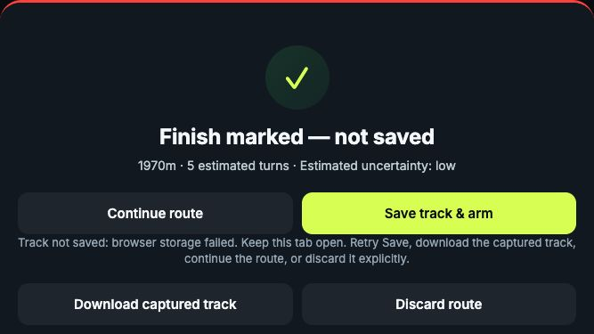

# Lap Timer Guide

GPS-based lap timing for an open telemetry project. Record circuits or stages, select a track to arm timing, and compare laps in the device dashboard. Position-matched reference pace and local recordings make it an inspectable DIY timing instrument. See the [capability comparison](COMPARISON.md) for packaged alternatives and the [hardware checklist](HARDWARE_VALIDATION.md) for measuring your setup.

---

## Quick Start

### Record a Track
1. Open dashboard at `192.168.71.1`
2. Open **Tracks** and choose circuit or stage recording
3. At a controlled site, record one circuit, or follow the stage to its finish
4. For circuits, review the loop-complete prompt. For stages, stop safely and tap **Mark Finish**
5. While parked, choose **Save track & arm**, enter a name, and check the confirmed timing state. A successful save and arm releases the capture panel.

If browser storage fails, the completed route stays in this tab with **Save track & arm** to retry and **Download captured track** to recover a portable version 2 track JSON file without another storage write. Check Files/Downloads before closing the tab. A retry uses the same captured identity; existing saved tracks are not overwritten. **Continue route** replaces the captured finish after confirmation; **Discard route** explicitly abandons an unsaved capture. An early finish with too few route points can still continue.

If the track saves but arming is not confirmed, the panel says so and offers **Retry arming**. This retries only device configuration, without creating another saved track. Check the connection and current timing state before retrying. You may close the saved capture and select it from Tracks later. Nearby-track suggestions resume after the completed capture closes.

A failed reference write appears in the dashboard warning area. The prior saved reference remains available; check browser storage and complete another valid lap/run to retry.

### Start Timing
For an existing saved track, or to arm again later:
1. Open **Tracks** → saved track → **Arm timing**
2. **Start line indicator** shows distance and direction: "Start line: 150 m ↗"
3. Drive across start line — timing begins automatically
4. Complete a clean lap/run to save a spatial reference; faster valid references replace it

### Watch the Delta
After first lap, delta bar shows real-time comparison:
- **Green** = ahead of the reference, **Red** = behind
- **Arrows** show trend: ▲ gaining, ▼ losing

---

## Delta Bar

The delta bar is the key feature — it shows *during the lap* if you're ahead or behind.

```
    -2.3s                     2.3 seconds AHEAD
◄████████████░░░░░░░░►        Green bar extends LEFT

    +1.5s                     1.5 seconds BEHIND
◄░░░░░░░░████████████►        Red bar extends RIGHT
```

**Scale:** ±2 seconds = full bar. Number shows actual delta if beyond ±2s.

**Glow effect:** Activates when delta exceeds 1 second for visual emphasis.

---

## Track Types

### Circuit (Loop)
Closed loop where start and finish are the same. While capturing the route, closure is detected after at least 150 m of GPS distance when the receiver position is within 12 m of the starting position. There is no heading gate for route closure. This capture prompt is separate from timed start/finish crossings, which require crossing the directed finite line.

*Use cases: controlled circuits and repeatable closed-course routes*

### Stage (Point-to-Point)
Separate start and finish. First record the route; stop safely at the end and tap "Mark Finish" to save its finish line. Arm the saved stage on a later pass to time it.

*Use cases: point-to-point routes, hill climbs, and rally stages. Normal road recordings are useful for diagnostics; performance testing belongs at a controlled site.*

UI shows "Run" instead of "Lap" and "Running" instead of "Timing."

---

## How Timing Works

### Line Detection
1. **Finite segment intersection** — the segment between consecutive fresh fixes intersects the saved timing line. Proximity alone does not start timing.
2. **Direction validation** — receiver velocity agrees with the recorded direction (±90°). Positions below 0.5 m/s do not trigger crossings.
3. **Guards** — loops use a 500 ms debounce; completed laps/runs must last at least 10 seconds. A second start crossing does not restart an active stage. Gaps over two seconds break crossing continuity.

### Precision
- Crossing detection on new GPS fixes, independent of browser refresh rate
- At 100 km/h, the vehicle travels about 1.11 m between 25 Hz fixes; that is sample spacing, not a position-error bound.
- Suitability for a particular timing requirement must be established against an independent reference.

### Delta Calculation
New references record position/time samples in the saved track's geographic frame. Current GPS position is projected onto nearby reference segments; direction, continuity, and competing nearby branches gate the match. Reference time is interpolated at the matched position, then subtracted from current elapsed time corrected for GPS fix age. The live delta is against the labeled reference, not necessarily the historical best.

Old distance-only references remain exportable; completing a clean lap/run creates a spatial replacement. New spatial references replace one another only when faster. A 12 m corridor and 60° direction gate are heuristics, not measured error bounds. Fresh stationary fixes preserve local continuity without displaying a delta. Gaps, ambiguous matches, and off-route positions suppress the estimate. Progress follows the matched trace and stops at 99%; firmware crossings remain the timing authority. This does not implement corner coaching or change firmware crossing timestamps.

---

## Timer States

```text
Idle -- select track --> Armed -- valid start crossing --> Timing
Timing -- circuit crossing --> Timing (next lap)
Timing -- stage finish --> Armed (ready for another run)
Armed or Timing -- deactivate --> Idle
```

| State | Display | Notes |
|-------|---------|-------|
| **Idle** | Drive recording panel | No track active; readiness or recording summary |
| **Armed** | Track name + start indicator | Waiting for line crossing |
| **Timing** | Running clock + delta bar | Active timing |

---

## Start/Finish Indicators

Arrow updates in real-time as you approach:

| Distance | Message |
|----------|---------|
| > 100m | "Start line: 250 m ↗" |
| 50-100m | "Approaching start: 75 m ↗" |
| 15-50m | "Almost there: 30 m ↗" |
| < 15m | "Cross to begin! ↗" |

For P2P tracks, similar messages show for finish line once timing starts.

---

## Route recording

This creates track geometry; it is separate from **Record session**, which captures raw telemetry/GPS. With no track selected, the [Drive recording panel](DRIVE.md) shows raw recording duration and partial GPS distance.

### During Recording
The overlay shows:
- Estimate status (a heuristic, not measured GPS accuracy)
- Distance traveled
- Estimated turn count
- Elapsed time

**Data checks:** Wait for fresh valid GPS and inspect the captured route before saving. A quality label does not establish position accuracy.

### Loop Detection
For circuits, **Circuit captured — not saved** appears when the closure criteria are met. Stages show **Finish marked — not saved** after marking the finish. Neither prompt means the track has been committed. Options:
- **Save Track** — open save dialog
- **Keep Driving** — continue recording; more samples do not guarantee better accuracy

### Tips
- Wait for GPS lock (cyan LED pulse)
- Drive smoothly and consistently
- Drive your typical racing line
- Don't push to the limit — smooth lap records better

---

## Track Auto-Detection

With fresh GPS near a saved track, Blackbox may offer **Track nearby** in a reserved notice row. It does not activate timing or start recording automatically. Choose **Activate** while parked to arm that track, or **Dismiss** to suppress it for the rest of this page session. An untouched suggestion expires after 10 seconds; that track waits at least 60 seconds before another offer. Stale GPS/connection data and track setup changes withdraw suggestions.

The existing matching heuristics check at most every three seconds and require two matching checks, using a 50 m centerline cutoff plus a distance/heading score. This is not a probability or an accuracy claim. Explicit dismissals are bounded to 256 IDs; at that limit, further automatic suggestions stop until reload rather than reviving dismissed tracks.

Compact landscape groups connection, recording and track notices in a bounded scrolling region. Warnings and suggestion actions remain accessible without covering the instruments.

---

## Session History

Observed completed laps are saved automatically, grouped by session. Multiple completions missed during a browser outage cannot all be reconstructed.

### Viewing
1. Open **Tracks**
2. Tap **History** next to a track with history
3. View sessions grouped by date

### What's Saved
- Every lap time with session grouping
- Best lap per session highlighted
- Reference lap (for delta) updated by a faster usable trace; an invalid trace cannot replace it

---

## Data Management

Open **Saved data** from the dashboard.

**Storage Overview:** Total usage, recordings vs tracks breakdown

**Recordings:** Export CSV, delete individual sessions, clear all

**Tracks:** Clear reference, delete track, clear all tracks

---

## Troubleshooting

### Timer Not Starting
**Causes:**
- The receiver-position segment did not cross the finite line (including because of GPS error or a near miss)
- Wrong direction approach
- Timing is not armed, or the saved finite line does not span the intended crossing
- GPS signal lost or degraded

**Solutions:**
- Check the saved line spans the route; approaching it alone does not start timing
- Ensure correct direction
- While parked, select the saved circuit/stage with **Arm timing**; cross its start line in the intended direction with fresh GPS
- Wait for GPS lock (cyan LED pulse) before starting

### Delta asks for a new reference
Complete a clean lap/run with fresh GPS throughout. Older distance-only references remain stored but cannot supply a spatial comparison. A suppressed delta does not stop firmware lap timing.

### Lap Times Seem Wrong
- Re-record with cleaner GPS
- Cross at reasonable speed
- Check diagnostics for GPS quality

### Loop Not Detected
- Distance < 150m? Keep driving
- Still more than 12 m from the recorded start? The route-capture closure prompt has not qualified
- Inspect the route and GPS reception while parked; closure has no heading gate

---

## Technical Reference

### Timing Precision
Crossing times are interpolated between two fresh GPS fixes and stored in integer milliseconds. Millisecond storage and smooth display do **not** establish millisecond physical accuracy. Receiver latency, timestamp alignment, multipath, line geometry, and speed all matter. For scale, 1 m of along-track error at 100 km/h corresponds to about 36 ms; this is an illustrative conversion, not a measured error bound.

### Storage Estimates
| Data | Size | 10 Tracks |
|------|------|-----------|
| Track definition | 5-20 KB | 200 KB |
| Reference lap | 30-60 KB | 600 KB |
| Lap history | 100 bytes/lap | 100 KB (1000 laps) |
| **Total** | | ~1 MB |

Browser quota varies; storage can fill or be evicted. Export important data and use the visible save/error status. Do not assume a fixed IndexedDB capacity.

### Corner Detection
State machine with hysteresis:
- Entry threshold: 0.025 rad/m (sharp turn)
- Exit threshold: 0.012 rad/m (straightening out)
- Minimum length: 3 meters

### Loop Detection Thresholds
| Parameter | Value |
|-----------|-------|
| Minimum GPS distance during route capture | 150 m |
| Closure proximity to recorded start | 12 m |
| Heading gate for route closure | None |

---

## Validation and limits

Synthetic replays cover multiple track headings, latitudes, irregular sample intervals, and timestamp rollover. They verify algorithm behavior with known inputs; they do not measure the receiver's real-world errors. See [Review & validation](REVIEW.md) for the remaining field test plan.

Timing uses fresh raw GPS positions and velocity from the same receiver. Gaps longer than two seconds break crossing continuity. A crossing during an outage may be missed; the software intentionally does not infer it from a long reconnect segment. Do not treat EKF interpolation or a higher display rate as additional position truth.

---

## GPS Coordinate Architecture

The lap timer uses **GPS lat/lon coordinates** instead of local EKF (Extended Kalman Filter) coordinates for timing line detection. This architectural choice ensures tracks work across device restarts and sessions.

### Why GPS Instead of EKF?

**The Problem:** Each time the device starts, the EKF computes a new local coordinate origin from the first few GPS fixes. This "GPS origin" varies by several meters between sessions. Tracks saved in one session had timing lines in that session's coordinate frame—unusable in a different session.

**The Solution:** Store and transmit timing lines as absolute GPS lat/lon coordinates. The firmware receives GPS directly from the sensor, eliminating any coordinate frame mismatch.

### How It Works

1. **Track Recording:** Dashboard records track using current GPS origin for local display
2. **Track Saving:** Timing line stored as local x,y + `gpsOrigin` reference
3. **Track Activation:** Dashboard converts local→GPS using track's own `gpsOrigin`
4. **Firmware API:** Receives GPS lat/lon directly (no session dependency)
5. **Line Detection:** Firmware converts GPS to local coords relative to timing line's p1

The key insight: each timing line carries its own GPS reference (the p1 endpoint). All coordinate math uses this consistent reference point.

### Known Limitations & Mitigations

#### GPS noise and line geometry

**Issue:** Consumer GPS has meter-scale uncertainty that changes with reception, antenna placement, and multipath. A fixed 1 m jitter bound is not established for this device.

**Mitigation:** The lap timer uses trajectory-based intersection detection—it checks if the *path* from previous position to current position crosses the timing line, not just proximity. This catches crossings between samples, but cannot eliminate position noise.

A sufficiently wide line reduces missed intersections near the track edge. Direction and minimum-lap gates reduce false triggers, but cannot guarantee their elimination. Verify that the saved line spans the route and that its direction matches the intended crossing.

#### GPS Dropout

**Issue:** During brief GPS signal loss (tunnels, heavy tree cover), no crossings are detected.

**Current Behavior:** The lap timer only processes valid GPS fixes. No detection during dropout is correct behavior—better than wrong detections.

An EKF fallback is a research option, not an implemented or validated replacement for missing fixes. It needs an explicit error model and independent crossing evidence before it can report a completed lap.

#### Coordinate Precision

**Numeric precision:** timing-line calculations and HTTP GPS coordinates use f64. Binary v4 packets retain f32 latitude/longitude for compatibility, introducing location-dependent quantization that can reach meter scale. Numeric representation is separate from GPS measurement accuracy.

**Local Conversion:** The `to_local()` function uses the timing line's p1 as reference, converting both line endpoints and vehicle position consistently. The intersection calculation uses f64 throughout.



Synthetic recovery example: keep the tab open and retry Save or download the captured track. Download recovery JSON before closing an unsaved route. A saved track and confirmed arming are separate outcomes.
