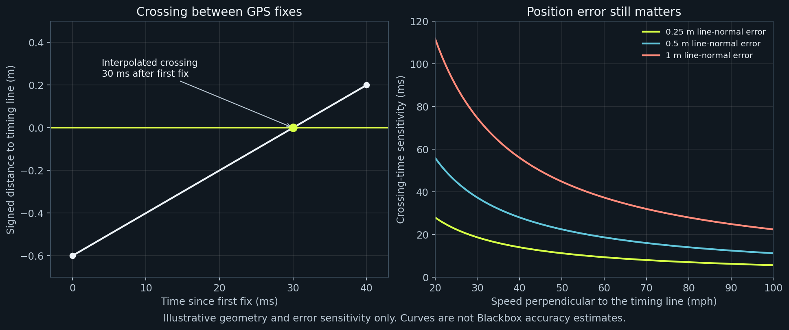
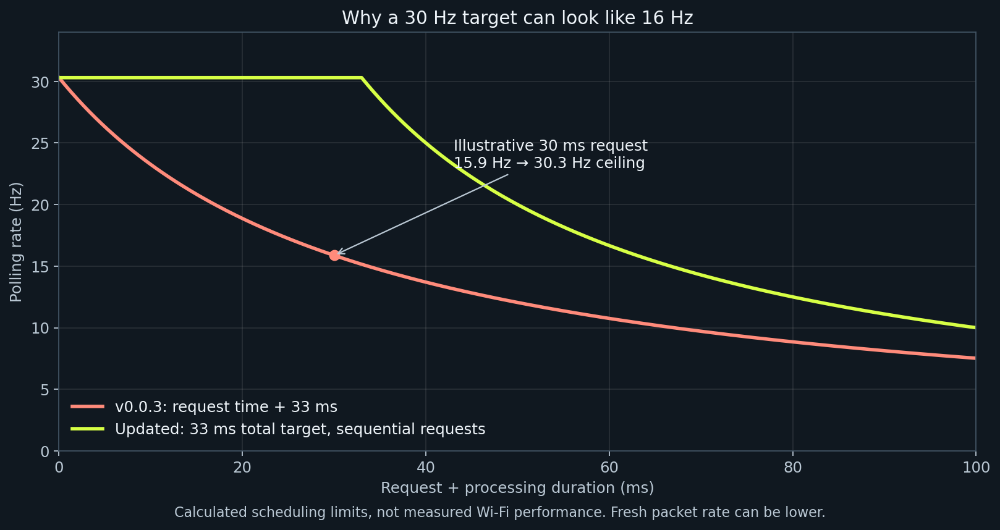

# Maths and update rates: what the numbers mean

This review describes the implemented pipeline, not a measured accuracy certificate. A fast display, a finely printed time and a high sensor output rate are different things.

## From receiver fixes to a lap time

The lap timer intersects the segment between consecutive valid GPS positions with a finite timing line. Direction, speed, freshness, plausible displacement and debounce checks gate the crossing. It uses double-precision geometry and interpolates the host timestamps associated with the two fixes. It does not time laps from a 200 Hz extrapolated EKF trajectory.

For signed perpendicular distances d0 and d1 on opposite sides of the line:

```
u = -d0 / (d1 - d0)
crossing_time = t0 + u * (t1 - t0)
```

For d0 = −0.6 m, d1 = +0.2 m and a 40 ms interval, u = 0.75 and the crossing is 30 ms after the first fix. At 60 mph (26.8224 m/s), the car travels 1.073 m between 25 Hz fixes, or 5.364 m between 5 Hz fixes. Interpolation avoids simply assigning the next fix's time; it does not remove position error or variable receiver/serial latency.



The first-order sensitivity is `time error ≈ line-normal position error / line-normal speed`. At 20 m/s perpendicular to the line, a hypothetical 1 m error corresponds to 50 ms. At a shallow crossing angle, the perpendicular speed is lower and sensitivity is worse. These are examples, not Blackbox error bounds. Printing milliseconds does not establish millisecond accuracy.

New GPS CSV evidence retains receiver UTC, host parse time, sequence gaps and reboot boundaries. The lap timer still uses its existing host clock. Host parse time means the completed sentence was processed, not PPS or the antenna measurement instant. Receiver epochs let us distinguish delivered GPS cadence from browser cadence and inspect batching. See [GPS logging](GPS_LOGGING.md).

## Why the old dashboard could show about 16 Hz

The v0.0.3 browser waited 33 ms **after** its request and processing completed. With an illustrative 30 ms request/processing cost:

```
old rate = 1000 / (33 + 30) = 15.9 Hz
new scheduling ceiling = 1000 / max(33, 30) = 30.3 Hz
```

The updated scheduler subtracts request time from the 33 ms budget and never overlaps requests. The visible UI counter divides accepted samples by actual elapsed time. Wi-Fi, rendering, repeated packets, background throttling and firmware scheduling can still lower it.



## Hardware budgets

| Layer | Configuration or calculated budget | What remains to measure |
| --- | --- | --- |
| NEO-M9N | Release target 25 Hz; 40 ms epochs | Delivered receiver epochs and accepted fixes outdoors |
| NEO-6M | Release target 5 Hz; 200 ms epochs | Actual configured and delivered cadence |
| GPS UART, 115200 baud, 8N1 | 11,520 payload bytes/s; 460.8 bytes per 25 Hz epoch | Total enabled NMEA/UBX message traffic |
| Illustrative 80-byte NMEA sentence | 6.94 ms on that UART; two such sentences take 13.89 ms | Actual lengths, message set and batching |
| WT901, three 11-byte packets at 200 Hz | 6,600 bytes/s; 66,000 wire bits/s (57.3% of 115200 baud) | Device output configuration and independent packet freshness |
| Same 33-byte cycle at 9600 baud | At most 29.1 cycles/s before other traffic | Autodetected baud and packet set |
| Force fusion and telemetry | Approximately 30 Hz configured path | Loop delays and sensor age |
| Browser | Approximately 30 Hz scheduling target | Accepted packet rate on each phone |

The GPS and IMU use separate UARTs. Four 11-byte IMU packets at 200 Hz would consume 88,000 wire bits/s. A baud rate alone does not configure the sensor's output rate. Startup baud detection does not prove 200 Hz acquisition. The firmware's GPS setup sends baud/rate/dynamic-model configuration; it does not yet verify all settings by readback or explicitly budget every enabled message.

The manufacturer specifies **up to 25 Hz with four concurrent GNSS** for the NEO-M9N. That is receiver capability, not evidence that a particular assembled Blackbox delivers every epoch: [u-blox NEO-M9N product summary](https://content.u-blox.com/sites/default/files/NEO-M9N_ProductSummary_UBX-19027207.pdf). RMC time and date semantics are described in the [u-blox M9 interface description](https://content.u-blox.com/sites/default/files/u-blox-M9-SPG-4.04_InterfaceDescription_UBX-21022436.pdf).

## What the estimator does

The seven states are `[x, y, yaw, vx, vy, accel_bias_x, accel_bias_y]`. With acceleration transformed to earth coordinates:

```
position += velocity * dt + 0.5 * (acceleration - bias) * dt²
velocity += (acceleration - bias) * dt
yaw += yaw_rate * dt
```

The covariance is a **diagonal approximation**, dropping cross-correlations between position, velocity, heading and bias. For one position/velocity axis the implemented prediction includes:

```
P_position += P_velocity * dt² + 0.25 * (P_bias + q_acc) * dt⁴
P_velocity += (P_bias + q_acc) * dt²
P_bias += q_bias * dt
```

Here q_acc is per-step acceleration variance, not a continuous-time white-noise density. This approximation is useful for a small embedded estimator but its uncertainty is not a calibrated probability of physical error. The displayed position sigma also has a heuristic 2.5 m floor. Neither the floor nor the sensor rate is an accuracy guarantee. GPS corrections constrain drift; outages, bias, orientation errors and unmodelled motion still matter.

## G-meter and peaks

The firmware sends a longitudinal estimate selected/blended from GPS speed change and corrected IMU acceleration, and a lateral estimate from `speed × corrected yaw rate`. The latter assumes approximately coordinated turning; banking, sideslip and mounting errors can violate the model. This force-fusion path runs at telemetry cadence, not the IMU's nominal maximum output rate.

The dashboard divides by 9.81 to show g and applies a time-based 70 ms exponential smoothing constant. Positive longitudinal means acceleration; negative means braking. Positive lateral is right, matching firmware packet convention. The plot places braking upward and acceleration downward; left/right position matches the signed lateral value. A previous UI inversion contradicted those labels and is corrected in this review.

The plot has a fixed selectable 0.5, 1 or 2 g outer radius, a three-second fading trail and an explicit over-scale indication. Values outside the circle are clipped geometrically; their numeric readouts remain visible. It clears on missing/old GPS or transport interruption. It also requires all three IMU packet types—acceleration, gyro and attitude—to have arrived within 200 ms. The HTTP metadata reports the age of the oldest packet; Session CSV retains it. Older firmware without this evidence shows an unavailable state. These are host-receive ages, not synchronized sensor measurement timestamps, so serial buffering and physical calibration remain limitations.

Peaks are the largest positive/negative **time-weighted 0.5 s averages** of the received force estimates, not single-sample maxima. The window uses trapezoidal integration with interpolation at its leading edge. It requires fresh GPS, speed at least 10 km/h and sample gaps no greater than 250 ms. The 10 km/h moving-sample threshold is a heuristic, not an accuracy guarantee. The shared qualification predicate accepts metres per second; ordinary v4 telemetry speed is km/h and is converted at its call site. Duplicate device timestamps add no evidence. Peaks last for the page session, reset with Reset, and are not a durable per-recording statistic yet. Historical peaks remain visible after a dropout; the live G-meter does not.

Differentiating speed amplifies noise: if successive speed errors were independent with standard deviation σv, acceleration noise would be approximately `sqrt(2) * σv / dt`. For illustrative σv = 0.05 m/s and dt = 0.04 s, this is 1.77 m/s², about 0.18 g. Real receiver errors are correlated; this calculation explains the need for filtering, not a prediction of this receiver's noise.

## Calibration on a driveway

Earlier startup/recalibration code assumed a stationary, level sensor and learned horizontal gravity as bias. At 3° tilt, `sin(3°) = 0.0523`, so about 0.052 g could be misclassified. The revised candidate subtracts the body-frame gravity vector predicted by fresh AHRS attitude before averaging:

```
gravity_x = -g * sin(pitch)
gravity_y =  g * sin(roll) * cos(pitch)
gravity_z =  g * cos(roll) * cos(pitch)
bias = mean(raw_acceleration - gravity_vector)
```

Tests recover known injected biases at level and combined modest pitch/roll angles; stale packets, rotation, nonfinite data and vibration are rejected. This is conditional on attitude accuracy, not an independent multi-pose calibration. A single pose cannot resolve all bias/attitude ambiguities. Initial hardware testing should still use level ground, then compare modest inclines. Horizontal mount alignment is separate; its 10° collection gate is not slope compensation. See [mount alignment](CALIBRATION.md).

## Hardware checks that software cannot replace

1. Establish the actual controller and receiver variant; use the matching firmware.
2. Calibrate level and stationary. Record the mounting orientation; verify right/left and acceleration/braking signs with gentle known motion.
3. Compare indicated speed against a suitable reference. Check stationary bias and rough-road behaviour.
4. Record an ordinary trip, then export Session CSV, GPS CSV and a backup while parked. Keep the page open until saving completes.
5. Inspect receiver intervals, duplicate epochs, missing sequences, parse-time batching and reboot boundaries with the GPS analysis tool.
6. Test loss/recovery of GPS and Wi-Fi: no frozen live G ball, no fabricated lap crossing, preserved recordings.
7. Validate timing lines and stages at a controlled site against independent timing evidence, across speeds and crossing angles. An ordinary highway trip validates logging and rate behaviour, not lap accuracy.
8. Test rotation, controls and fullscreen on both actual phones; desktop viewport screenshots cannot prove mobile browser behaviour.

The demo is synthetic. Its bounded residual noise and rough patch exercise the interface; neither demonstrates the noise spectrum, calibration accuracy or timing precision of real hardware.
