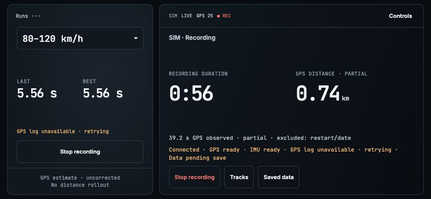

# Rolling speed-interval estimates

The landscape **Runs** instrument reports the last and best rolling acceleration intervals from GPS evidence collected while recording. The interval button opens ordinary page buttons with the same readable type as the closed control. Choose a family using the current **Menu → Speed units** preference:

| Family | mph preference | km/h preference |
| --- | --- | --- |
| Lower speed | 30–60 mph | 50–100 km/h |
| Overtaking | 45–70 mph | 80–120 km/h |

These are purpose counterparts, not exact unit conversions. Changing units preserves the selected family and shows that preset's own results; it never converts or relabels a completed time. All four independent detectors keep collecting qualified evidence during recording, regardless of the displayed instrument or units. Selecting a family does not reset recording, timing or detector history. The opened chooser scrolls when space is short; Escape returns focus to its interval button, and choosing an option, clicking outside or leaving Runs closes it.

Tap the instrument name to reveal the picker and select Runs, or swipe horizontally. **Record session** uses the ordinary recording flow; no performance maneuver is required for an ordinary neighborhood or highway data-collection trip.

This first implementation is an uncorrected GPS estimate. It is not a validated drag timer, and it does not yet implement standing-start 0–60 mph. Defining launch from noisy near-zero speed needs separate validation; a nonzero threshold must not silently be sold as a true zero-speed start. There is no distance rollout, slope correction, wind correction or vehicle-efficiency inference.

## Receiver-log health

Runs shows an amber status when its GPS timestamp log is unavailable or no new receiver events have arrived for more than 2.5 seconds. Ordinary dashboard telemetry can remain live during a log failure; it is a separate input. The display distinguishes waiting for initial timestamps, waiting for fresh timestamps and a failed log request. Last and best accepted results remain visible.

This is a display-readiness interval, not a new timing gate. A temporary HTTP failure does not by itself invalidate a pending interval: the retained receiver window may still provide complete evidence after recovery. Existing sequence, epoch, quality and continuity rules decide the result. Late responses from a previous recording cannot replace the current recording's status. The demo menu's **Pause GPS timestamp log** control demonstrates this condition without stopping ordinary synthetic telemetry.

## Timing and rejection rules

- Use receiver UTC epochs, never browser receipt times. Interpolate the start and finish between adjacent speed observations: `crossing = t0 + (threshold − speed0)/(speed1 − speed0) × (t1 − t0)`.
- Require at least 200 ms of continuous valid evidence below the selected start speed minus 0.44704 m/s (1 mph), then a rising start crossing sustained for 80 ms within 0.15 m/s of the threshold. Starting a recording above the lower threshold does not invent the missing start.
- Require accepted active fixes, finite speed/course and UTC with at least two fractional digits. Consecutive receiver intervals must be 20–300 ms, with consecutive sequence numbers in the same boot and date.
- Reject a capture gap, backwards/duplicate UTC, restart, date boundary, speed change over 15 m/s², heading deviation over 15° from the start, or an attempt lasting over 120 seconds. Identical sequence duplicates add no evidence.
- Confirm the selected finish crossing with at least 80 ms of subsequent evidence no more than 0.15 m/s below the threshold. This rejects a brief threshold spike. The reported finish time remains the interpolated crossing, not the confirmation time.
- Returning below the start speed minus 0.44704 m/s aborts an unfinished attempt and permits rearming. A date change is conservatively rejected rather than guessing midnight/leap-second behaviour.

These gates reject some bad data, not every plausible GNSS error. Heading is GPS course, not steering angle. Two displayed decimals describe numerical resolution, not measured timing accuracy.

## Evidence, saving and export

The browser polls the bounded GPS log while recording. Its initial batch can include up to 64 buffered receiver events from before the record button was pressed. Runs analysis includes that explicitly retained pre-roll. Interrupted background collection can lose evidence; sequence gaps reject affected attempts.

Last/best display values reset with a new recording or page reload. **Saved data → Runs CSV** reconstructs accepted and rejected attempts from the stored GPS evidence, including source sequence endpoints, boot/date, receiver crossing times and the synthetic marker. Export GPS CSV alongside it to retain all underlying observations. Backup/restore already preserves those GPS rows; there is no separate result database that can drift away from its evidence. More than 1000 attempts require exporting the full GPS CSV instead of silently truncating the derived export.

A run may never qualify: a short recording, no lower-threshold crossing, missing receiver time, an interrupted stream or a turn can all explain that. An empty result is not zero seconds.

CSV interval names retain their literal fixed thresholds for all four detectors, independently of the currently displayed units. Labelled real-drive precision/recall evaluation is tracked in [issue #79](https://github.com/jctoledo/blackbox/issues/79).

## Try the synthetic scenario

The demo starts with a clearly labelled saved rolling example: two accepted attempts and a third rejected by a deliberate six-event GPS gap for each of the four presets. Its Last/Best values come from the same GPS evidence available in Saved data, not a separately invented result. Starting your own recording resets those example results.

In the website demo, open **Menu → Simulate rolling interval**, then record a session and select **Runs** in landscape. This explicitly changes the synthetic data source to a straight-line acceleration/deceleration scenario and disarms circuit timing. The 2 m/s² acceleration produces an interpolated 45–70 interval of 5.588 s (displayed as 5.59 s); 30–60 mph takes 6.7056 s, 50–100 km/h takes 6.9444 s, and 80–120 km/h takes 5.5556 s. The menu can return to the textured circuit scenario. **SIM** remains visible; these are not measured driving results.

## Remaining acceptance

Replay known recordings and compare repeated controlled runs against independent timing before making an accuracy claim. Check rate, speed noise, course stability, slope/wind context, phone background interruption and saved-data recovery. Standing starts, braking-distance tests and custom intervals remain separate work in issue #62.

Synthetic regressions cover exact crossing times, incomplete lead-in, threshold spikes, gaps, restarts and duplicate events. They do not establish real-drive precision, recall or F1. Hold out entire trips and use independently labelled positives and negatives before tuning or claiming detection quality.

Check opened and closed chooser readability and touch/keyboard focus on physical Android and iPhone browsers, including short landscape cards. Desktop device emulation does not establish physical-phone behaviour.

This synthetic interruption leaves ordinary telemetry live. Runs retains completed estimates; Drive keeps the qualified distance partial rather than guessing across the missing log.
