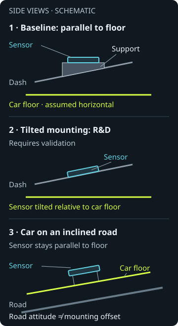

# Mounting tilt: frames, present limits and pending corrections

Reviewed 2026-11-21 against `a226d2a`. This is source-only research: no builds, automated tests, sensor configuration changes, flashing or physical measurements were performed. Proposed corrections below remain pending implementation and independent review. Read alongside [sensor fusion](../SENSOR_FUSION.md), [experimental alignment](../CALIBRATION.md) and [hardware acceptance](../HARDWARE_VALIDATION.md).

## Accepted mounting contract

The maintainer confirmed the baseline: the sensor plane is parallel to the car floor, with that floor assumed horizontal for setup. Use a small support or wedge if a sloping dashboard would otherwise tilt the sensor. A sensor following a non-horizontal mounting surface is an R&D extension requiring validation. When the car climbs or banks, a sensor still parallel to its floor changes attitude with the car; that is road/vehicle attitude, not a changed mounting offset. This accepted product contract supplements the historical source audit at `a226d2a` below; it does not claim that tilted installations have been validated.



## Source audit at a226d2a: dashboard or hood mount

A fixed tilted mounting surface is mathematically compatible with three-axis attitude and acceleration transforms. It does **not** establish that Blackbox firmware at the audited commit accepts an arbitrary tilt accurately. The acceleration path already removes gravity using roll/pitch and rotates all three acceleration components, but angular-rate consumers still receive sensor-body Z rate, and the stationary gate still receives gravity-containing horizontal acceleration. Both create tilt-dependent behavior. This conclusion comes from source inspection, not a measured vehicle result. [Acceleration transforms](../../framework/src/transforms.rs), [application call sites](../../sensors/blackbox/src/main.rs), [stationary predicate](../../framework/src/stationary.rs)

For current operation, follow the existing nearly level, securely mounted setup and verify axis signs. No universal “safe tilt angle” follows from the sources or software thresholds. A dash or hood location requires evidence about attitude quality, installation configuration, magnetic disturbance, vibration and temperature in that actual installation. The existing horizontal alignment workflow does not estimate a complete sensor-to-car rotation. [Calibration scope and instructions](../CALIBRATION.md)

## Three angular quantities that must stay distinct

Use the repository's right-handed active rotation `R = Rz(ψ) Ry(θ) Rx(φ)`, taking sensor-body vectors into the local earth frame. Let `φ` be roll, `θ` pitch, `ψ` mathematical yaw and `(p,q,r) = (wx,wy,wz)` body angular velocity in rad/s. The WT901 datasheet states a Z-Y-X Euler sequence; its pictured module axes must still be reconciled with the physical board and configured installation direction. The formulas below use Blackbox's declared rotation and signs, rather than treating a vendor axis label as proof of vehicle-forward alignment. [WT901 datasheet v23-0608, p.13](https://www.sensor-test.de/assets/Fairs/2025/ProductNews/PDFs/WT901-Datasheet.pdf), [repository rotation](../../framework/src/transforms.rs)

For this sequence, the exact body-rate equations are:

```text
p = φdot − ψdot sinθ
q = θdot cosφ + ψdot sinφ cosθ
r = −θdot sinφ + ψdot cosφ cosθ

ψdot = (q sinφ + r cosφ) / cosθ
```

NASA's large-angle model separates body rates from Euler rates in Appendix G-3 (printed p.94, PDF p.98); its degrees-per-second factor is omitted here because all rates above are radians per second. The inverse is singular at `cosθ = 0`, and becomes sensitive to noise near that condition. An implementation needs explicit validity/freshness checks and a defined singularity policy, not just a division. [NASA TM-78629, Appendix G-3](https://ntrs.nasa.gov/api/citations/19780005098/downloads/19780005098.pdf#page=98)

Rotating the angular-velocity **vector** gives a different scalar:

```text
ωearth,z = −p sinθ + q sinφ cosθ + r cosφ cosθ
         = ψdot − φdot sinθ
```

This is the third row of `R` applied to `(p,q,r)`, derived here from the repository's rotation matrix. Thus `wz`, Euler heading derivative `ψdot`, and earth-vertical angular velocity `ωearth,z` are generally different. Earth-Z projection is not a general replacement for the derivative of an Euler yaw state. They coincide when the relevant additional terms vanish; at a level pose, `ψdot = r`. [Rotation implementation](../../framework/src/transforms.rs), [NASA Euler-rate reference](https://ntrs.nasa.gov/api/citations/19780005098/downloads/19780005098.pdf#page=98)

As a derived ideal example, hold sensor roll/pitch constant while turning about earth vertical at rate `Ω`. Then `(p,q,r) = Ω(−sinθ, sinφ cosθ, cosφ cosθ)`. Raw Z rate is `Ω cosφ cosθ`, whereas the Euler conversion recovers `Ω`. At pure 30° pitch raw Z underreads by about 13.4%. A separate check with nonzero roll rate and pitch should distinguish earth-Z projection from Euler yaw derivative. These are arithmetic examples, not tested mounting tolerances.

A constant *horizontal* sensor-to-vehicle yaw offset adds a constant to yaw and leaves its derivative unchanged. A general fixed three-dimensional mounting rotation needs its own sensor-to-vehicle transform: the azimuth of a tilted sensor X axis need not track vehicle heading with one constant offset through changing vehicle attitude. [Current horizontal alignment definition](../CALIBRATION.md)

## Gravity, stationary detection and road attitude

The existing gravity model is:

```text
gbody = g [−sinθ, sinφ cosθ, cosφ cosθ]
linear_body = bias_corrected_acceleration − gbody
linear_earth = R linear_body
```

Consequently a perfectly stationary sensor on an incline can have substantial body X/Y readings before gravity removal. `get_accel_corrected()` subtracts bias only; it does not remove gravity. Yet `main.rs` passes those readings to `SensorManager::update_stationary`, whose predicate requires each horizontal component below `0.18 g`. Pure pitch reaches that threshold at approximately `asin(0.18) = 10.37°`; for pure roll the same arithmetic applies. This is a source-derived rejection boundary under ideal conditions, **not** a recommended maximum mounting angle. GPS freshness, speed, yaw-rate and five consecutive fixes also affect the decision. [Driver](../../drivers/wt901/src/lib.rs), [call site](../../sensors/blackbox/src/main.rs), [manager](../../sensors/blackbox/src/system.rs), [predicate](../../framework/src/stationary.rs)

Fixed sensor tilt and road slope/bank are different quantities. Writing `R_earth_sensor = R_earth_vehicle R_vehicle_sensor` separates changing vehicle attitude from constant mounting. AHRS roll/pitch describe the sensor's combined attitude to earth; they alone do not identify which part came from mounting. Exact attitude and the full gravity vector can remove gravity in either case, but this does not create a validated slope-compensated vehicle-performance measurement. The present alignment estimates horizontal orientation, and the startup bias procedure's incline-aware residual uses the AHRS attitude; neither independently observes every bias, tilt error and sustained acceleration. [Calibration limits](../CALIBRATION.md), [fusion limits](../SENSOR_FUSION.md)

`speed × heading_rate` is a planar lateral-acceleration approximation when vehicle heading follows velocity direction. Banking, grade, changing sideslip and vertical motion require a clearer target frame and motion model; neither body Z nor earth-Z alone makes it exact. For example, the acceleration along a banked vehicle's lateral axis differs from horizontal earth acceleration. This is a kinematic inference from the defined frames, not a measured correction already supplied by Blackbox. [Current force model](../../framework/src/fusion.rs), [documented assumptions](../SENSOR_FUSION.md)

## Manufacturer caveats relevant to placement

- **Installation direction:** the vendor protocol defines `ORIENT` at `0x23`: horizontal by default, or vertical with the Y-axis arrow upward. This is a discrete mode, not arbitrary mounting calibration. Check the actual module/firmware and output-axis semantics before using a vertical mode; Blackbox's inspected driver does not configure this register. [Official WIT protocol, ORIENT](https://wit-motion.gitbook.io/witmotion-sdk/wit-standard-protocol/wit-standard-communication-protocol), [driver](../../drivers/wt901/src/lib.rs)
- **Magnetic heading:** the datasheet's nine-axis accuracy assumes calibration without magnetic interference; six-axis operation has cumulative dynamic integration error. Its stated heading number differs from the current product page, so neither number is a validated Blackbox installation accuracy. A hood or dash near metal/electrical equipment needs heading checks in situ. [Manufacturer datasheet, p.10](https://www.sensor-test.de/assets/Fairs/2025/ProductNews/PDFs/WT901-Datasheet.pdf#page=10), [manufacturer product specifications](https://www.wit-motion.com/index.php/Module/84.html)
- **Vibration:** the manufacturer warns that cumulative errors in vibration require actual testing. Filtering is not evidence that an engine/hood mounting meets an accuracy target. [Manufacturer product specifications, heading notes](https://www.wit-motion.com/index.php/Module/84.html)
- **Temperature:** the product page specifies temperature-dependent accelerometer/gyro drift and an operating range of −40 to +85°C. Sun/engine exposure is therefore an installation question; the module rating alone does not qualify the whole enclosure, power system or mounting. [Manufacturer product specifications](https://www.wit-motion.com/index.php/Module/84.html)

The dash/hood implications above are engineering inferences, not manufacturer approval of either location.

## Proposed software work and acceptance evidence at audit time

1. Define the angular-rate contract for each consumer. The EKF integrates `ψ += wz × dt`, while `main.rs` supplies raw body `wz`; force fusion and mode classification also receive it. For an Euler-yaw state, review a body-to-Euler conversion using fresh matched roll/pitch and all required gyro components. Audit the alignment collection's straightness gate separately. Do not silently substitute earth-vertical projection or call the result mount-independent. [Application](../../sensors/blackbox/src/main.rs), [EKF](../../framework/src/ekf.rs), [fusion](../../framework/src/fusion.rs)
2. Supply gravity-free acceleration to stationary detection using an explicit frame contract. Review all callers and stale/invalid-attitude behavior; maintain GPS freshness and sustained evidence. Consider full-vector angular motion for a future stationary policy rather than assuming one axis detects all rotation. [Manager](../../sensors/blackbox/src/system.rs), [predicate](../../framework/src/stationary.rs)
3. On lat, validate known three-axis rotations, level equivalence, compound tilt, nonzero roll/pitch rates, sign conventions, stale/nonfinite samples and singularity handling. Include stationary tilted gravity vectors and moving counterexamples. These checks are proposed and were not run for this research.
4. Establish physical acceptance separately: record module identity/settings, mount photos/angles, cold/warm behavior, stationary residuals, known rotation signs, vibration and GPS/IMU cadence; repeat after remounting. Compare nearly level and tilted installations against an independent reference under controlled conditions. Do not close hardware/slope-compensation claims on synthetic results. [Existing hardware checklist](../HARDWARE_VALIDATION.md)
